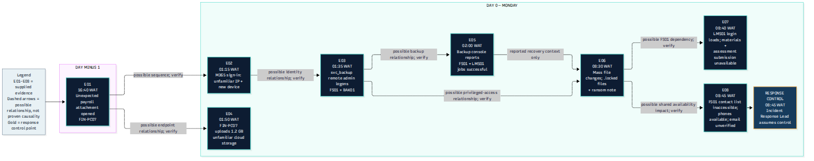
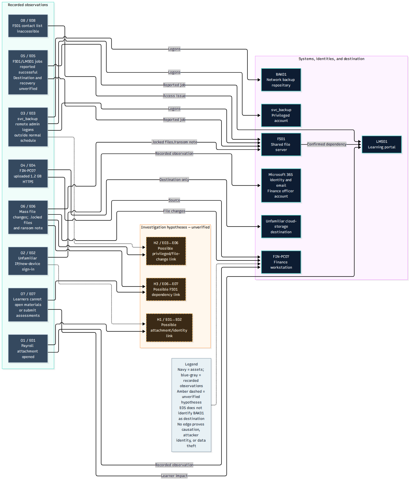
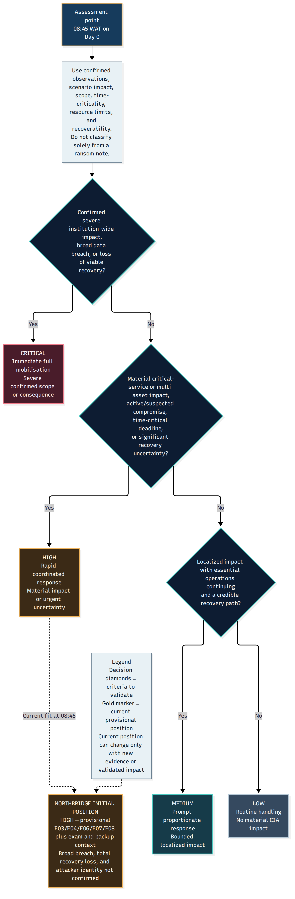
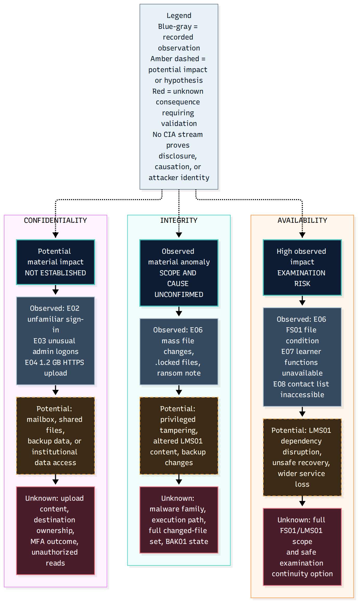
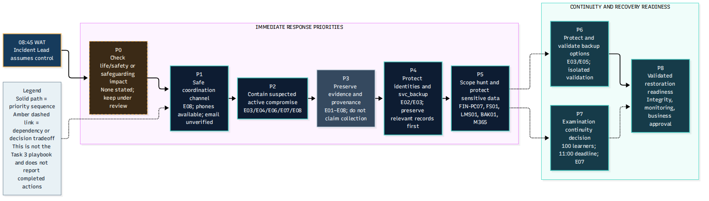

# Task 1 — Incident Assessment and Initial Classification

## Overview

This directory contains the completed initial incident assessment
for the fictional ransomware scenario at **Northbridge Skills Institute**,
developed as part of the ICDFA GRC105 assignment.

The purpose of the assessment is to organise the reported evidence,
understand the potential operational consequences, justify an initial
incident severity classification, and establish defensible
investigation and response priorities.

The assessment preserves the distinction between **reported scenario
facts**, **working hypotheses**, **unanswered questions** and
**proposed response actions**. It does not claim that actual digital
forensic acquisitions or live containment actions were performed.

## Scenario context

The fictional institute supports approximately 1,800 learners and
90 staff. Its key services include a learning management portal,
a shared file server, Microsoft 365 services and backup infrastructure.

The scenario includes a disrupted learning service and a scheduled
online examination for approximately 100 learners at **11:00 WAT
on Day 0**.

The initial incident assessment was made at **08:45 WAT on Day 0**.

**Initial severity: High — provisional.**

This is a defensible starting classification, not an immutable or
officially approved organisational determination.

## Key assessment principles

- Maintain traceability to the E01–E08 scenario evidence.
- Separate observations from hypotheses and alternative explanations.
- Treat suspicious network activity as an investigative lead, not
  automatically as confirmed data exfiltration.
- Treat backup-job success as distinct from verified recoverability.
- Recognise that service availability, data integrity and possible
  confidentiality exposure require separate consideration.
- Reassess severity as material evidence becomes available.
- Preserve evidence and authorisation boundaries in proposed response
  priorities.

## Primary assessment documents

| Document | Purpose |
|---|---|
| [Integrated Task 1 Assessment](TASK-1-INTEGRATED-ASSESSMENT.md) | Principal consolidated academic deliverable |
| [Stage 1 Review](STAGE-1-REVIEW.md) | Historical evidence-assessment quality review |
| [Stage 2 Review](STAGE-2-REVIEW.md) | Historical severity and impact quality review |

The historical review files document development checkpoints.
They should not be mistaken for an outstanding requirement
to perform additional stages.

## Directory navigation

| Directory | Contents |
|---|---|
| [analysis/](analysis/) | Seven explanatory incident-analysis documents |
| [data/](data/) | Six structured assessment registers and matrices |
| [diagrams/](diagrams/) | Five editable Mermaid diagram sources |
| [visuals/](visuals/) | Five rendered diagrams with detailed explanations and downloads |
| [deprecated-templates/](deprecated-templates/) | Preserved superseded scaffolds |
| [exports/](exports/) | Export organisation and rendering guidance |

## Analytical documentation

- **[Scenario Context and Impact](analysis/scenario-context-and-impact.md)** — Introduces the fictional Northbridge Skills Institute environment, affected services, operational dependencies and examination constraints.
- **[Incident Chronology](analysis/incident-chronology.md)** — Organises the reported events into a time-based incident record, preserving their evidence identifiers and temporal relationships.
- **[Observations, Hypotheses and Questions](analysis/observations-hypotheses-questions.md)** — Separates reported observations from possible explanations and unanswered investigation questions.
- **[Severity Classification](analysis/severity-classification.md)** — Documents the initial provisional High severity assessment and its supporting rationale.
- **[Severity Reassessment Triggers](analysis/severity-reassessment-triggers.md)** — Identifies developments that could justify changing the initial incident severity classification.
- **[Confidentiality, Integrity and Availability](analysis/cia-impact-assessment.md)** — Assesses the potential security and business consequences across the confidentiality, integrity and availability dimensions.
- **[Response Prioritisation](analysis/response-prioritisation.md)** — Explains the proposed order of response activities and their relationship to operational and evidentiary priorities.

## Structured datasets

- **[Evidence Analysis Register](data/evidence-analysis-register.csv)** — Structured interpretation of the available incident evidence, including the separation of observations and uncertainty.
- **[Asset Impact Register](data/asset-impact-register.csv)** — Records relevant systems and their potential or observed operational impact.
- **[CIA Impact Matrix](data/cia-impact-matrix.csv)** — Presents confidentiality, integrity and availability considerations in a structured format.
- **[Investigation Priorities](data/investigation-priorities.csv)** — Organises investigation questions and priorities for the proposed response.
- **[Response Priority Matrix](data/response-priority-matrix.csv)** — Documents prioritised response concerns and the basis for their ordering.
- **[Severity Criteria](data/severity-criteria.csv)** — Supports consistent severity assessment and reassessment.

## Visual overview

The following figures summarise different aspects of the assessment.
Click an image to open its scalable SVG version.

For detailed explanations, individual formats and editable diagram
sources, see the [visual documentation gallery](visuals/).

### Incident Timeline

**Figure description:** Presents the chronological relationship between the reported incident observations. The timeline supports sequencing, but does not establish that each event was causally connected.

**Interpretation:** Read the events alongside the incident chronology and evidence-analysis register. Preserve reported WAT times and distinguish confirmed observations from hypotheses.

**Files:** [PNG](visuals/incident-timeline.png) · [SVG](visuals/incident-timeline.svg) · [Editable Mermaid](diagrams/incident-timeline.mmd)

### Investigation Relationships

**Figure description:** Maps relationships between relevant assets, accounts, observations and investigative questions.

**Interpretation:** Connections represent relationships that require analysis; a drawn connection is not proof of compromise, attribution or a confirmed attack path.

**Files:** [PNG](visuals/investigation-relationships.png) · [SVG](visuals/investigation-relationships.svg) · [Editable Mermaid](diagrams/investigation-relationships.mmd)

### Severity Decision Tree

**Figure description:** Illustrates the structured reasoning used for the initial incident classification and subsequent reassessment.

**Interpretation:** The initial classification is High — provisional at 08:45 WAT on Day 0. New verified findings may require reassessment under documented criteria.

**Files:** [PNG](visuals/severity-decision-tree.png) · [SVG](visuals/severity-decision-tree.svg) · [Editable Mermaid](diagrams/severity-decision-tree.mmd)

### CIA Impact Assessment

**Figure description:** Provides a visual aid to the confidentiality, integrity and availability assessment.

**Interpretation:** Potential confidentiality exposure must not be confused with confirmed data theft. Service disruption and integrity concerns should also be evaluated separately.

**Files:** [PNG](visuals/cia-impact-visual.png) · [SVG](visuals/cia-impact-visual.svg) · [Editable Mermaid](diagrams/cia-impact-visual.mmd)

### Response Priority Workflow

**Figure description:** Illustrates how incident-response priorities can be sequenced while preserving evidence and maintaining appropriate operational decision controls.

**Interpretation:** This is a proposed decision-support workflow, not a record of actions actually executed against systems.

**Files:** [PNG](visuals/response-priority-workflow.png) · [SVG](visuals/response-priority-workflow.svg) · [Editable Mermaid](diagrams/response-priority-workflow.mmd)

## Evidence limitations

The scenario contains several observations that require further
verification. In particular, this repository does not treat
suspicious execution, anomalous sign-ins, privileged-account
activity, unusual transfers or successful backup jobs as
automatic proof of the associated security conclusions.

The evidence-based limits of the initial assessment are
explained in the integrated assessment and supporting analyses.

## Relationship to the remaining assignment

This task provides the evidentiary foundation for the subsequent
incident response governance, operational playbook,
communications, tabletop simulation and case-study analysis.

The incident assessment should be interpreted as a fictional
training exercise rather than a completed live investigation.

[Return to the repository overview](../README.md)
