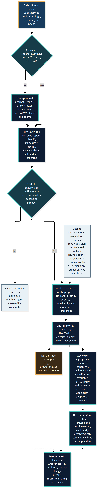
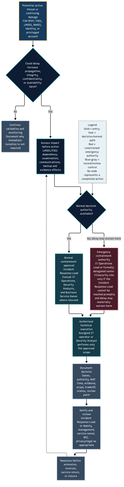
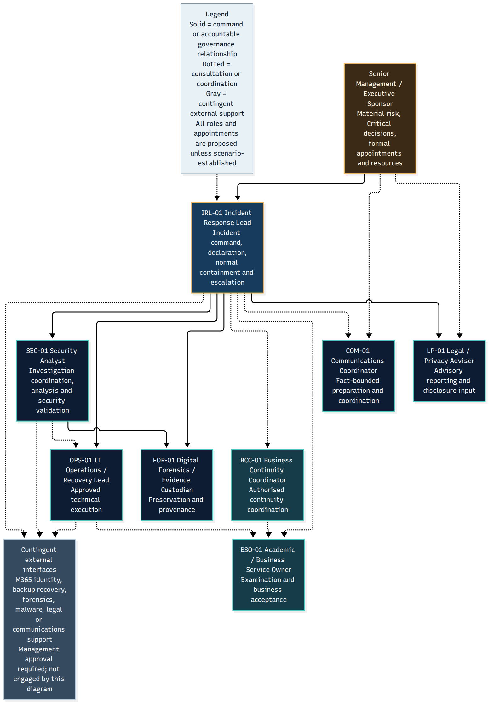
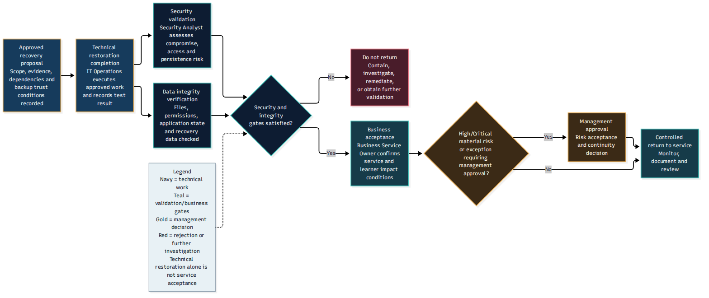

# Task 2 — Incident Response Plan, Governance and CSIRT

## Overview

This directory contains the proposed incident response governance
framework for the fictional Northbridge Skills Institute ransomware
scenario, developed for the ICDFA GRC105 assignment.

The work explains how an incident response capability can be organised,
how decisions should be authorised, how specialist functions can
coordinate, and how operational recovery should be governed.

It combines incident response policy, management and technical
authority, CSIRT organisation, a responsibility-assignment matrix,
continuity integration and preparation improvements.

**Academic status:** The Task 2 assessment material has been completed,
reviewed and incorporated into the final coursework. These are
proposed institutional arrangements, not policies formally approved
or implemented by an actual institution.

## Scenario and staffing assumptions

Northbridge is a fictional educational institution with approximately
1,800 learners and 90 staff.

The scenario identifies three IT personnel and one security analyst.
The CSIRT model therefore distinguishes *functional roles*
from the number of employees available to fill those roles.

It accounts for limited capacity, overlapping responsibilities,
delegated authority, specialist advice and conditional outside support.

The 11:00 WAT online examination creates an operational continuity
constraint, but it does not justify bypassing evidence-preservation,
security-validation or restoration-approval requirements.

## Governance principles

1. Separate incident recognition, declaration and response activation.
2. Assign a primary decision authority for each governance activity.
3. Distinguish normal containment authority from limited emergency action.
4. Record decisions, exceptions, delegations and supporting rationale.
5. Coordinate incident response with continuity and academic operations.
6. Preserve separate technical, security, integrity and business
   acceptance gates before service restoration.
7. Distinguish planned organisational controls from established facts.
8. Escalate legal/privacy considerations without assuming that a
   reportable data breach has been confirmed.

## Main Task 2 deliverables

| Document | Purpose |
|---|---|
| [Incident Response Policy](policy/incident-response-policy.md) | Proposed incident response policy and governance commitments |
| [Governance Plan](plans/incident-response-governance-plan.md) | Declaration, escalation, decision rights and management coordination |
| [CSIRT Organisation](csirt/csirt-organisation-and-command.md) | Functional roles and incident command |
| [Staffing Model](csirt/staffing-capacity-and-support-model.md) | Realistic staffing and support constraints |
| [RACI Matrix](raci.csv) | Activity responsibility and accountability assignments |
| [RACI Methodology](csirt/raci-methodology-and-accountability.md) | Interpretation and accountability rules |
| [Readiness Improvements](readiness/preparation-improvements.md) | Four proposed improvements and validation measures |

## Directory guide

| Subdirectory | Contents |
|---|---|
| [policy/](policy/) | Proposed incident response policy |
| [plans/](plans/) | Four detailed governance and continuity plans |
| [csirt/](csirt/) | CSIRT organisation, capacity and accountability |
| [data/](data/) | Governance matrices, role register, crosswalk and decision-log template |
| [readiness/](readiness/) | Proposed preparedness improvements |
| [diagrams/](diagrams/) | Eight editable Mermaid sources and previews |
| [visuals/](visuals/) | Eight rendered figures with detailed interpretations |

## Authority and accountability

The governance framework contains a 14-activity authority consistency
matrix and a separate 22-activity RACI.

The authority matrix identifies primary governance decision ownership;
the RACI assigns responsibility and accountability for operational
activities. The crosswalk explains how the two models correspond.

A decision authority and an activity executor should not be treated
as interchangeable simply because they contribute to the same response.

See:

- [Authority Consistency Matrix](data/authority-consistency-matrix.csv)
- [Authority–RACI Crosswalk](data/authority-raci-crosswalk.csv)
- [RACI Activity Matrix](raci.csv)
- [Duty Conflict and Coverage Register](data/duty-conflict-and-coverage-register.csv)

## Featured governance visuals

The diagrams below provide introductory visual summaries.
The full [eight-figure gallery](visuals/) includes detailed
explanations and downloadable sources.

### Incident Declaration and Activation

[Editable Mermaid source](diagrams/incident-declaration-activation.mmd)

### Emergency Isolation Authority

[Editable Mermaid source](diagrams/emergency-isolation-authority.mmd)

### CSIRT Organisational Structure

[Editable Mermaid source](diagrams/csirt-organisational-structure.mmd)

### Recovery Approval Gates

[Editable Mermaid source](diagrams/recovery-approval-gates.mmd)

## Evidence and implementation limitations

The policy, role structure, controls and decision routes are proposed
for an academic scenario. They do not establish that Northbridge has
formally adopted these procedures or appointed these individuals.

Incident observations and hypotheses remain governed by the
Task 1 assessment. In particular, possible exposure is not confirmed
exfiltration, and backup-job success is not evidence of recoverability.

## Relationship to the other tasks

- [Task 1 — Incident Assessment](../01-incident-assessment/)
  provides the scenario evidence and provisional severity decision.
- [Task 3 — Response Playbook](../03-response-playbook/)
  develops planned operational response and recovery procedures.
- [Task 4 — Communications](../04-communications/)
  develops stakeholder messaging and escalation.
- [Task 5 — Tabletop Simulation](../05-tabletop-simulation/)
  tests the proposed decisions in a fictional exercise.

[Return to repository overview](../README.md)
