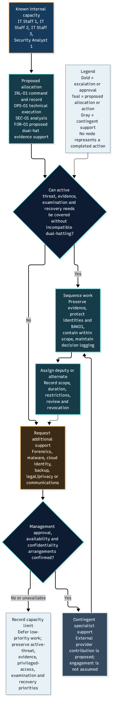
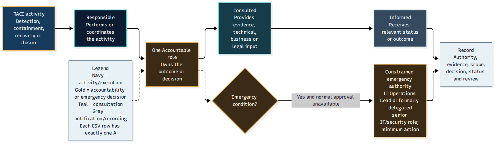

# Task 2 — CSIRT Structure, Staffing and Accountability

## Purpose

This directory explains the proposed Computer Security Incident
Response Team (CSIRT) organisation for Northbridge Skills Institute.

The design distinguishes required functions from actual available
staffing so that the proposal remains realistic for a small
internal technology team.

## CSIRT documentation

### 1. CSIRT Organisation and Command

**Document:** [csirt-organisation-and-command.md](csirt-organisation-and-command.md)

Sets out functional incident response roles, command relationships, escalation and specialist advice.

### 2. Staffing and Capacity Model

**Document:** [staffing-capacity-and-support-model.md](staffing-capacity-and-support-model.md)

Addresses realistic capacity, dual-hatting, delegation, sequencing and conditional external support.

### 3. RACI Methodology and Accountability

**Document:** [raci-methodology-and-accountability.md](raci-methodology-and-accountability.md)

Explains responsibility, accountability, consultation and information flows across the response activities.

## Functional response coverage

The organisational design includes:

1. Incident leadership and coordination.
2. Security analysis and investigation.
3. Digital forensics and evidence custody.
4. IT operations, containment and recovery.
5. Legal and privacy advice.
6. Stakeholder communications.

Additional governance and business-continuity functions
are documented in the role register where appropriate.

The design recognises three IT staff and one security analyst
as the explicitly available technical capacity in the scenario.

Functional roles do not necessarily represent separate people
or permanently staffed positions.

## Capacity and delegation safeguards

The staffing model addresses concurrent workload, role overlap,
deputy coverage and escalation when specialist assistance is needed.

An external legal adviser, forensic specialist or service provider
should not be described as already retained without supporting
scenario evidence.

Management approval and business-owner decisions must not be
implicitly reassigned through technical incident delegation.

## RACI interpretation

The [22-activity RACI matrix](../raci.csv) identifies activity-level
responsibility and accountability.

The RACI methodology explains the meaning of Responsible,
Accountable, Consulted and Informed, including treatment of
combined roles and separation of decision gates.

The [authority crosswalk](../data/authority-raci-crosswalk.csv)
connects operational accountability to the governing authority model.

## CSIRT visuals

### Proposed Organisational Structure

The diagram presents functional reporting and coordination
relationships, not a claim that every role is a dedicated employee.

### Staffing and Escalation

The diagram supports capacity planning and escalation decisions
under limited staffing.

### RACI Accountability Workflow

The workflow helps distinguish execution responsibilities
from the ownership of important decisions.

## Related files

- [CSIRT Role Register](../data/csirt-role-register.csv)
- [Duty Conflict Register](../data/duty-conflict-and-coverage-register.csv)
- [Governance Plan](../plans/incident-response-governance-plan.md)
- [Visual Gallery](../visuals/)
- [Task 2 Overview](../README.md)
