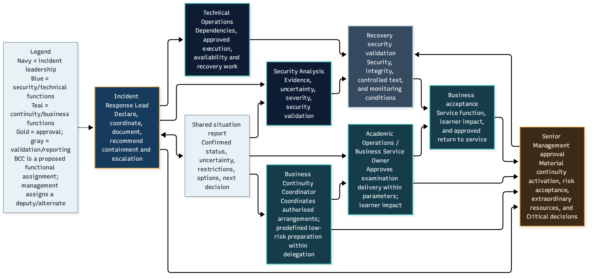

# Task 2 — Governance and Continuity Plans

## Overview

This directory contains four detailed plans supporting the
proposed incident response policy.

Together, they describe decision ownership, escalation,
containment authority, incident documentation and coordination
with business continuity.

## Plan catalogue

### 1. Response Governance Plan

**Document:** [incident-response-governance-plan.md](incident-response-governance-plan.md)

Describes incident declaration, activation, escalation, organisational authority and coordination.

### 2. Isolation and Emergency Decisions

**Document:** [isolation-authority-and-emergency-decisions.md](isolation-authority-and-emergency-decisions.md)

Distinguishes routine containment authorisation from narrowly defined emergency action, exceptions and subsequent review.

### 3. Incident Documentation Procedure

**Document:** [incident-documentation-procedure.md](incident-documentation-procedure.md)

Explains the proposed recording of decisions, evidence, authority, actions and review information.

### 4. Business Continuity Integration

**Document:** [business-continuity-integration.md](business-continuity-integration.md)

Connects incident response decisions with examination continuity, service restoration and business acceptance.

## How the plans work together

The governance plan establishes who leads and approves decisions.

The isolation-authority plan clarifies who may authorise normal
containment and when exceptional emergency action may be permitted.

The documentation procedure provides the decision and evidence
recordkeeping framework.

The business-continuity integration plan coordinates cybersecurity
response with academic services, continuity measures and controlled
return to operation.

## Decision-making safeguards

- Record the basis and timing of material decisions.
- Document delegations, exceptions and subsequent reviews.
- Do not treat a deputy appointment as automatically transferring
  every form of management or business authority.
- Keep security clearance separate from business acceptance.
- Do not assume that a successful backup job means recovery
  can proceed safely.
- Use accessible alternative communication channels when
  primary systems are unavailable or untrusted.

## Related decision diagrams

### Emergency Isolation Authority

This diagram should be read with the isolation-authority plan.

### Business Continuity Coordination

This diagram shows the relationship between security response
and continuity decision-making.

### Recovery Approval Gates

This diagram illustrates why restoring technical functionality
alone is insufficient for operational acceptance.

## Supporting records

- [Authority Consistency Matrix](../data/authority-consistency-matrix.csv)
- [Decision Log Template](../data/incident-decision-log-template.csv)
- [Authority–RACI Crosswalk](../data/authority-raci-crosswalk.csv)
- [Complete Visual Gallery](../visuals/)
- [Task 2 Overview](../README.md)
