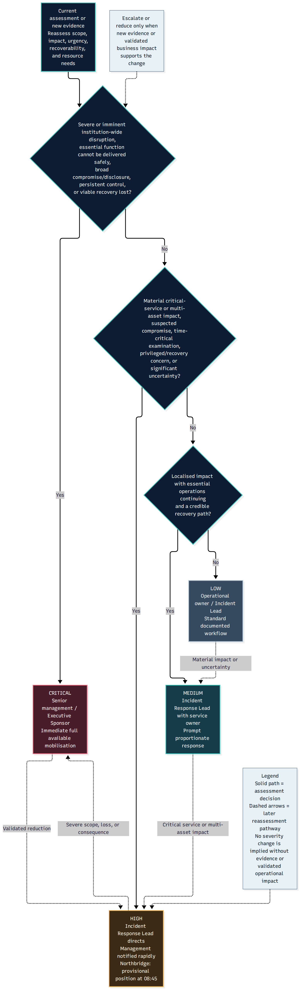

# Task 2 — Governance, CSIRT and Recovery Visual Gallery

## Overview

This directory contains eight rendered diagrams supporting
the Task 2 incident response governance assessment.

All eight PNG diagrams are displayed below, so GitHub
visitors can inspect them without opening the files individually.

Clicking an embedded preview opens the corresponding SVG.
The original Mermaid sources remain available for editing.

## Governance and escalation diagrams

---

### Figure 1 — Incident Declaration and Activation

#### Purpose

Explains the proposed relationship between incident recognition, formal declaration, response activation and command responsibilities.

#### Interpretation

Declaration and team activation are distinct governance decisions.

#### Files and formats

| Format | Link | Purpose |
|---|---|---|
| PNG | [Open preview](incident-declaration-activation.png) | GitHub preview or image insertion |
| SVG | [Open scalable figure](incident-declaration-activation.svg) | Vector display and reporting |
| Mermaid | [Open editable source](../diagrams/incident-declaration-activation.mmd) | Editing and diagram maintenance |

---

### Figure 2 — Severity and Escalation Workflow

#### Purpose

Illustrates how severity assessment informs escalation and leadership involvement.

#### Interpretation

The Northbridge High classification remains provisional and subject to reassessment.

#### Files and formats

| Format | Link | Purpose |
|---|---|---|
| PNG | [Open preview](severity-escalation-workflow.png) | GitHub preview or image insertion |
| SVG | [Open scalable figure](severity-escalation-workflow.svg) | Vector display and reporting |
| Mermaid | [Open editable source](../diagrams/severity-escalation-workflow.mmd) | Editing and diagram maintenance |

---

### Figure 3 — Emergency Isolation Authority

#### Purpose

Shows the distinction between ordinary containment approval and limited emergency containment authority.

#### Interpretation

Emergency action requires the documented conditions, records and retrospective review; it is not unrestricted authority.

#### Files and formats

| Format | Link | Purpose |
|---|---|---|
| PNG | [Open preview](emergency-isolation-authority.png) | GitHub preview or image insertion |
| SVG | [Open scalable figure](emergency-isolation-authority.svg) | Vector display and reporting |
| Mermaid | [Open editable source](../diagrams/emergency-isolation-authority.mmd) | Editing and diagram maintenance |

---

### Figure 4 — Incident Response and Business Continuity Coordination

#### Purpose

Illustrates coordination between security-led incident response, continuity planning and academic/business service decisions.

#### Interpretation

Operational continuity decisions and technical recovery approvals are not interchangeable.

#### Files and formats

| Format | Link | Purpose |
|---|---|---|
| PNG | [Open preview](ir-business-continuity-coordination.png) | GitHub preview or image insertion |
| SVG | [Open scalable figure](ir-business-continuity-coordination.svg) | Vector display and reporting |
| Mermaid | [Open editable source](../diagrams/ir-business-continuity-coordination.mmd) | Editing and diagram maintenance |

## CSIRT, accountability and recovery diagrams

---

### Figure 5 — CSIRT Organisational Structure

#### Purpose

Presents the functional roles and command relationships proposed for managing the incident.

#### Interpretation

The chart describes functions, not an assertion that each function is staffed by a separate employee.

#### Files and formats

| Format | Link | Purpose |
|---|---|---|
| PNG | [Open preview](csirt-organisational-structure.png) | GitHub preview or image insertion |
| SVG | [Open scalable figure](csirt-organisational-structure.svg) | Vector display and reporting |
| Mermaid | [Open editable source](../diagrams/csirt-organisational-structure.mmd) | Editing and diagram maintenance |

---

### Figure 6 — Staffing and Escalation

#### Purpose

Illustrates how limited internal staffing, escalation, role coverage and conditional specialist support interact.

#### Interpretation

External support is a proposed escalation option, not a confirmed engaged service provider.

#### Files and formats

| Format | Link | Purpose |
|---|---|---|
| PNG | [Open preview](csirt-staffing-and-escalation.png) | GitHub preview or image insertion |
| SVG | [Open scalable figure](csirt-staffing-and-escalation.svg) | Vector display and reporting |
| Mermaid | [Open editable source](../diagrams/csirt-staffing-and-escalation.mmd) | Editing and diagram maintenance |

---

### Figure 7 — RACI Accountability Workflow

#### Purpose

Visualises responsibility and accountable decision ownership through the response lifecycle.

#### Interpretation

A RACI assignment is a proposed governance allocation, not evidence that any operational action occurred.

#### Files and formats

| Format | Link | Purpose |
|---|---|---|
| PNG | [Open preview](raci-accountability-workflow.png) | GitHub preview or image insertion |
| SVG | [Open scalable figure](raci-accountability-workflow.svg) | Vector display and reporting |
| Mermaid | [Open editable source](../diagrams/raci-accountability-workflow.mmd) | Editing and diagram maintenance |

---

### Figure 8 — Recovery Approval Gates

#### Purpose

Separates technical restoration from security checks, data integrity validation and business acceptance.

#### Interpretation

Technical accessibility alone does not mean a system is safe or approved to return to service.

#### Files and formats

| Format | Link | Purpose |
|---|---|---|
| PNG | [Open preview](recovery-approval-gates.png) | GitHub preview or image insertion |
| SVG | [Open scalable figure](recovery-approval-gates.svg) | Vector display and reporting |
| Mermaid | [Open editable source](../diagrams/recovery-approval-gates.mmd) | Editing and diagram maintenance |

---

## Rendering and validation context

The existing diagram exports were previously reported
as validated for file integrity, readability, clipping,
overlapping labels and appropriate decision relationships.

Tall diagrams may require larger display sizes.
Wide diagrams may be better viewed at full page width.

This documentation task does not modify or rerender
the existing images.

## Key interpretive safeguards

- Diagrams represent proposed governance procedures.
- Normal containment and emergency containment are distinct.
- CSIRT functions do not imply one dedicated employee per role.
- Outside support is conditional unless independently established.
- Technical restoration is different from security validation.
- Data integrity and business acceptance require distinct attention.
- A diagram is not evidence of a completed operational decision.

## Related materials

- [Editable Diagrams](../diagrams/)
- [Governance Plans](../plans/)
- [CSIRT Organisation](../csirt/)
- [Authority and RACI Registers](../data/)
- [Task 2 Overview](../README.md)
