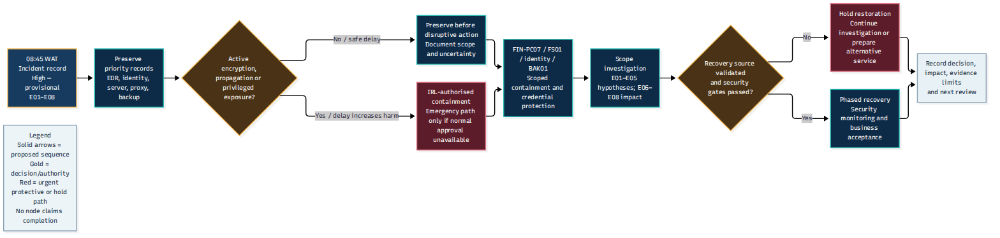

# Task 3 — Response and Recovery Visual Gallery

## Overview

This directory presents the rendered workflow figures
supporting the Task 3 response playbook.

Each image is embedded directly in the README so that
GitHub visitors can view it alongside its purpose,
interpretation and source links.

These diagrams are conceptual response-planning
artifacts, not photographic or forensic evidence.

---

## Figure 1 — Incident Response Workflow

### Description

Illustrates the planned sequence of incident response activities, from assessment and containment through investigation, eradication planning, recovery and closure.

### How to interpret this diagram

The workflow is a proposed response model. It does not demonstrate that systems were isolated, evidence was collected, or recovery was completed.

The workflow provides a visual reference to the
response lifecycle, but individual containment,
investigation and recovery decisions must remain
subject to appropriate evidence and governance.

### Associated documentation

- [Main Response Playbook](../TASK-3-RESPONSE-PLAYBOOK.md)
- [Response Actions Register](../data/response-actions.csv)

### File formats

- [Full-size PNG](response-workflow.png)
- [Scalable SVG](response-workflow.svg)
- [Editable Mermaid source](../diagrams/response-workflow.mmd)

---

## Figure 2 — Recovery Decision Workflow

### Description

Illustrates the decision-making considerations associated with validating backups, restoring technical services and authorising operational use.

### How to interpret this diagram

Technical accessibility does not independently establish security clearance, data integrity or business acceptance.

The diagram reinforces the need to consider
backup suitability, recovery validation and
the conditions required for safe return to service.

A technically available application or restored
file server does not by itself prove that the
institution is ready to resume normal operations.

### Associated documentation

- [Main Response Playbook](../TASK-3-RESPONSE-PLAYBOOK.md)
- [Evidence Register](../data/evidence-register.csv)

### File formats

- [Full-size PNG](recovery-decision.png)
- [Scalable SVG](recovery-decision.svg)
- [Editable Mermaid source](../diagrams/recovery-decision.mmd)

---

## Relationship between the diagrams

The response workflow describes the broader
operational sequence.

The recovery decision workflow focuses on
conditions and approvals associated with
the return of affected services.

Both are needed because executing recovery
activities and authorising business resumption
are different concerns.

## Image usage guidance

PNG files are useful for direct GitHub previews
and insertion into ordinary documents.

SVG files preserve scalability and are preferable
where high-resolution display is needed.

Editable Mermaid sources are maintained separately
for future revision.

## Evidentiary and operational limitations

The diagrams must not be interpreted as proving:

- Confirmed ransomware execution or attribution.
- Confirmed personal-data exfiltration.
- Completed evidence acquisition.
- Successful backup validation.
- Completed malware eradication.
- Authorised production restoration.

They support an academic incident response plan
based on the fictional Northbridge scenario.

## Navigation

- [Editable Diagram Sources](../diagrams/)
- [Canonical Data Registers](../data/)
- [Complete Playbook](../TASK-3-RESPONSE-PLAYBOOK.md)
- [Task 3 Overview](../README.md)
