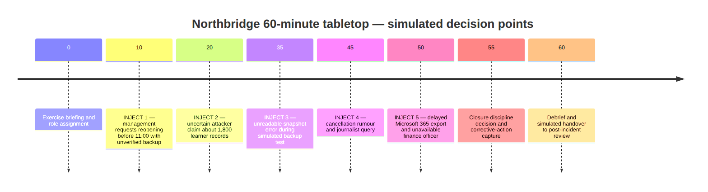

# Task 5 — Tabletop Timeline Visual Gallery

## Overview

This directory presents the rendered timeline for the
fictional 60-minute Northbridge ransomware tabletop exercise.

The image is embedded directly below to allow GitHub
visitors to understand the exercise sequence without
having to open an image file separately.

The diagram should always be interpreted alongside
the narrative exercise and the canonical decision log.

---

## Figure 1 — Ransomware Tabletop Exercise Timeline

### Figure description

This timeline illustrates the sequence of scenario
developments presented during the simulated exercise.

It makes the progression of management, recovery,
privacy and stakeholder communication challenges
easier to follow.

### Exercise structure

| Exercise minute | Scenario development |
|---|---|
| 10 | Management pressure to reopen before the examination |
| 20 | Unverified attacker claim concerning learner records |
| 35 | Failed backup test restoration |
| 45 | Social-media rumour and journalist enquiry |
| 50 | Additional scenario development documented in the main exercise |

### How to interpret the timeline

The times are elapsed minutes within the planned exercise.

They do not represent actual clock times when a
ransomware attack, public notification or restoration
occurred.

The figure helps assess the sequence of simulated
decisions and the changing pressures on the response team.

It should not be interpreted as proof that an operational
incident response exercise was conducted.

### Supporting materials

- [Complete Tabletop Exercise](../TASK-5-TABLETOP-EXERCISE.md)
- [Decision Log](../data/exercise-decision-log.csv)
- [Corrective Action Register](../data/corrective-actions.csv)

### Available image formats

| Format | File | Purpose |
|---|---|---|
| PNG | [Open PNG](tabletop-timeline.png) | GitHub preview and image insertion |
| SVG | [Open SVG](tabletop-timeline.svg) | Scalable visual for reports |
| Mermaid | [Open source](../diagrams/tabletop-timeline.mmd) | Editable diagram definition |

---

## Visual maintenance

The PNG and SVG files are rendered outputs.

The editable source is maintained separately in
the `diagrams/` directory.

Any future revision should preserve agreement
between the diagram, exercise narrative and
canonical decision records.

This README update does not regenerate or modify
the image files.

## Interpretation limitations

The figure is an educational representation of
a fictional tabletop exercise.

No actual system restoration, live notification,
evidence acquisition or real incident decision
is demonstrated by this timeline.

## Navigation

- [Editable Diagram](../diagrams/)
- [Canonical Exercise Records](../data/)
- [Main Exercise](../TASK-5-TABLETOP-EXERCISE.md)
- [Task 5 Overview](../README.md)
