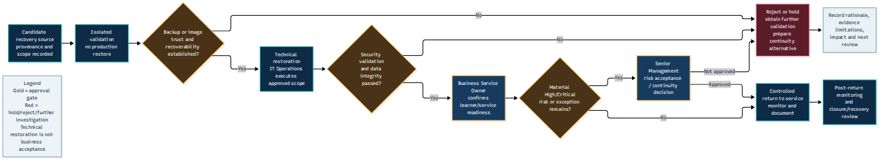

<!-- TASK3-DOCUMENTATION-START -->
# Task 3 — Incident Response and Recovery Visuals

This directory presents the two workflow diagrams developed
to support the Northbridge Skills Institute ransomware
response playbook.

Each figure is displayed below with an explanation and links
to the source and rendered versions.

---

## Figure 1 — Incident Response Workflow

### Description

This figure provides a visual overview of the proposed
incident response process.

It helps readers follow the progression from initial
assessment through containment, investigation,
eradication planning, controlled recovery and closure.

The diagram represents an educational response plan;
it does not document incident response actions performed
in a live environment.

### Available formats

- [View full-size PNG](response-workflow.png)
- [View scalable SVG](response-workflow.svg)
- [View editable Mermaid source](../diagrams/response-workflow.mmd)

---

## Figure 2 — Recovery Decision Workflow

### Description

This figure illustrates the decision-making process
associated with restoring affected systems after a
suspected ransomware incident.

The workflow supports decisions relating to:

- Backup suitability and recoverability.
- Security validation.
- Data integrity.
- Service readiness.
- Authorised operational restoration.

The figure reinforces that a technically accessible
system is not automatically safe or approved for use.

### Available formats

- [View full-size PNG](recovery-decision.png)
- [View scalable SVG](recovery-decision.svg)
- [View editable Mermaid source](../diagrams/recovery-decision.mmd)

---

## Interpretation and limitations

Both diagrams are conceptual and based on the Task 3
incident response plan.

They should not be interpreted as proof that evidence
was collected, systems were isolated, backups were
restored or incident recovery was completed.

## Related documentation

- [Complete Task 3 Playbook](../TASK-3-RESPONSE-PLAYBOOK.md)
- [Canonical Data Registers](../data/)
- [Editable Diagram Sources](../diagrams/)
- [Task 3 Overview](../README.md)
<!-- TASK3-DOCUMENTATION-END -->
