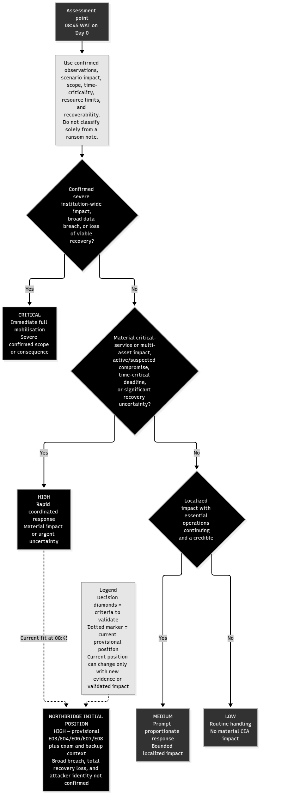
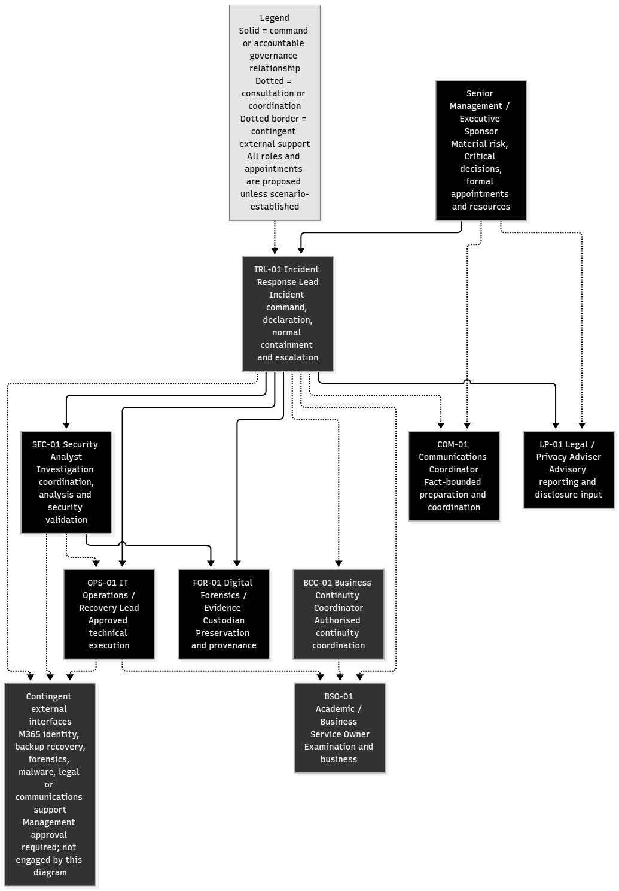

# ICDFA GRC105

## Incident Response Planning and Ransomware Response Simulation

**Northbridge Skills Institute — Evidence-Based Assessment Report**

| Student information | Details |
|---|---|
| Student | Ayuba Amadi |
| Registration number | 2025/GCR/12684 |
| Official email | gcr2512684@students.icdfa.edu.ng |
| Programme | GRC Engineering (CGRCE) |
| School | School of Cyber Risk, Governance and Compliance |
| Cohort | Batch B2025 |
| Academic session | 2026 |
| Level / year | Level 1 / Year 1 |
| Course | GRC105 — Incident Management and Business Continuity |
| Assignment | Incident Response Planning and Ransomware Response Simulation |
| Assessment weight | 20% |
| Final report word count | 918 words; narrative text excludes cover, contents, tables and references. |

**Document status:** Final draft for academic review; no live incident response, forensic acquisition, restoration or deployment is claimed.

# Contents

1. Task 1 — Incident Classification and Initial Assessment ................................ 3
2. Task 2 — Incident Response Plan and Team Responsibilities ................. 21
3. Task 3 — Response Playbook and Evidence Preservation ...................... 39
4. Task 4 — Communication and Escalation ............................................... 49
5. Task 5 — Tabletop Exercise and Improvement Plan ............................... 53
6. Task 6 — Case Study Analysis and Critical Reflection ........................... 59
7. References ................................................................................................ 59
8. AI-assistance acknowledgement ............................................................. 60

*Page references are generated from the rendered PDF and verified by the build script.*

# Task 1 — Incident Classification and Initial Assessment

**Organisation:** Northbridge Skills Institute (fictional)
**Assessment point:** 08:45 WAT on Day 0
**Current initial severity:** **High — provisional**
**Scope:** Task 1 only. No Task 2–6 content is included.

## Incident classification and initial assessment

The evidence is consistent with a suspected ransomware or destructive file-impact event involving possible identity misuse, possible unauthorized transfer, and possible backup compromise. The classification is not based solely on the ransom note. It is based on the combination of observed file and learner-service impact, unusual privileged activity, uncertain data transfer, time-critical examination impact, and uncertain recovery capability.

### Initial classification: High — provisional

High is justified by:

- E06: mass file changes on FIN-PC07 and .locked files plus a ransom note in FS01 shared folders;
- E07: learners cannot open materials or submit assessments, creating confirmed learner-facing availability impact;
- E08: the FS01 incident contact list is inaccessible and corporate email trust is unverified;
- E03: svc_backup made unusual remote administrator logons to FS01 and BAK01;
- E04: FIN-PC07 uploaded 1.2 GB over HTTPS to an unfamiliar cloud-storage destination;
- the 11:00 examination for 100 learners, the institute’s sensitive information holdings, limited staffing, and uncertain backup recoverability.

The assessment is not Critical at 08:45 because the evidence does not confirm institution-wide loss, broad data disclosure, compromise of every recovery path, or persistent attacker control. The portal login still loads, staff phones are available, and the event scope and causal chain remain unverified. These limitations do not remove the urgency; they explain the provisional High decision.

### Observed, suspected, and unconfirmed impact

| Category | Current assessment |
|---|---|
| Observed impact | E06 file-change indicators on FIN-PC07/FS01; E07 learner-facing portal functions unavailable; E08 contact-list access problem; E03 unusual privileged logons; E04 upload event. |
| Suspected impact | Ransomware or destructive file activity; privileged misuse or lateral movement; dependency-driven LMS01 disruption; possible identity misuse; possible backup-risk activity. |
| Unconfirmed consequences | Malicious execution from E01; account compromise from E02; personal-data transfer in E04; BAK01 tampering; malware family; institution-wide spread; attacker identity. |
| Additional evidence needed | Endpoint process/file telemetry; Microsoft 365/MFA/device data; Windows and backup logs; proxy/cloud metadata; application and dependency checks; isolated backup validation; broader scope hunt. |

Full four-tier criteria are in analysis/severity-classification.md and data/severity-criteria.csv.

## Evidence-linked timeline and uncertainty

The complete E01–E08 chronology, Day minus 1/Day 0 distinction, 08:45 WAT control point, possible relationships, and unverified-link statements remain in:

- analysis/incident-chronology.md
- data/evidence-analysis-register.csv
- diagrams/incident-timeline.mmd

The observations/hypotheses/questions separation and alternative explanations remain in analysis/observations-hypotheses-questions.md. No Stage 2 conclusion changes the Stage 1 evidence record.

## Assets and scope

The asset-impact register distinguishes assets with observed impact from assets that require investigation. At 08:45:

- **Affected or service-impacted for assessment:** FIN-PC07, FS01, and LMS01.
- **Requires urgent investigation but not confirmed affected:** BAK01, Microsoft 365 identity/email, svc_backup, the finance officer account, and supporting telemetry/coordination services.
- **Potentially affected data:** learner contact, admission, assessment, finance, credential, mailbox, shared-file, backup, and response-contact information. No data category is confirmed exfiltrated.

See data/asset-impact-register.csv for business functions, evidence, confirmed impact, potential impact, priority, and verification requirements.

## CIA assessment

### Confidentiality

**Potential material impact — not established.** E02, E03, and E04 create possible access or transfer paths, but none proves account compromise, unauthorized reads, or the content of the 1.2 GB upload. The institution’s information holdings make the questions important, not resolved.

### Integrity

**Observed material anomaly; scope and cause unconfirmed.** E06 shows mass file changes and .locked files/ransom note indicators. E03 creates a privileged-access integrity concern. E05 does not establish backup integrity, application consistency, or cleanliness.

### Availability

**High observed impact to important services, with examination risk.** E06 and E08 show FS01 access/file problems. E07 shows learners cannot access materials or submit assessments. The stated LMS01 dependency on FS01 and the 11:00 examination make this time-critical. Availability impact is not evidence of data disclosure.

See analysis/cia-impact-assessment.md and data/cia-impact-matrix.csv for the separate property assessments.

## Response priorities

The response priority order is:

1. Check life-safety or safeguarding consequences; none are stated in the supplied scenario.
2. Establish safe coordination using staff phones or another approved channel while email trust is checked.
3. Contain suspected active compromise while preserving high-value evidence.
4. Preserve endpoint, identity, network, server, backup, application, EDR, and helpdesk records with provenance.
5. Protect the finance officer account, Microsoft 365 identity, and svc_backup through an approved decision.
6. Hunt for broader scope and protect potentially sensitive institutional information.
7. Protect and validate backup options in isolation.
8. Make an evidence-informed examination-continuity decision; do not reopen the portal solely because of the deadline.
9. Prepare validated restoration and monitoring criteria for later recovery work.

The detailed matrix is in analysis/response-prioritisation.md and data/response-priority-matrix.csv. Detailed ordered actions, custody fields, restoration acceptance criteria, and communications remain in later Task 3/4 work and are not completed here.

## Severity and scope reassessment

Severity should increase to Critical if evidence confirms severe examination or institution-wide disruption, broad compromise, material data disclosure, persistent privileged control, or loss of all viable recovery options. High should be maintained while material service impact, unresolved privileged activity, uncertain data impact, or unvalidated recovery persists.

Severity may reduce only after evidence supports bounded scope, authorized identity/privileged activity, a legitimate unrelated transfer, no active destructive activity, safe service continuity, and validated recovery. An asset may be excluded from confirmed affected scope only when records show no related unauthorized access, change, persistence, or service impact and the asset is not needed to explain another observation.

The complete trigger and validation register is in analysis/severity-reassessment-triggers.md.

## Evidence gaps and limitations

The assessment does not have the original attachment, complete identity/mailbox logs, endpoint process/file telemetry, source hosts and commands for svc_backup, full server/application/backup logs, cloud-destination ownership/object data, forensic images, hashes, custody records, or restoration results. Server EDR coverage is incomplete. No forensic acquisition, hash verification, restoration test, account reset, containment action, notification, or service restoration is claimed.

The High classification is therefore a defensible initial decision under uncertainty, not a final finding about attacker identity, data theft, malware family, or total scope.

## References

- ICDFA GRC105 Incident Response Assignment, Northbridge Skills Institute scenario, initial evidence pack E01–E08, Task 1 instructions, and marking rubric.
- ICDFA, Incident-Response-Planning.pptx, Week 20 slides 4, 6, 9, 10, and 11.
- Nelson, A., Rekhi, S., Souppaya, M., and Scarfone, K. (2025). NIST SP 800-61r3, Incident Response Recommendations and Considerations for Cybersecurity Risk Management: A CSF 2.0 Community Profile. [Official NIST publication](https://doi.org/10.6028/NIST.SP.800-61r3).

{width=2.75in}

**Figure 1 — Initial severity decision logic.**

**Evidence analysis register — evidence core**

| Evidence ID | Timestamp (WAT) | Original source | Confirmed observation |
| --- | --- | --- | --- |
| E01 | Day minus 1 16:40 WAT | Assignment brief, Initial evidence pack: user report and mail record | A finance officer opened an unexpected payroll attachment on FIN-PC07. The supplied record does not verify execution of malicious code. |
| E02 | Day 0 01:15 WAT | Assignment brief, Initial evidence pack: Microsoft 365 audit | The finance officer account signed in from an unfamiliar IP address and a new device. MFA status and the user's involvement are unknown. |
| E03 | Day 0 01:35 WAT | Assignment brief, Initial evidence pack: Windows logs | The svc_backup account made remote administrator logons to FS01 and BAK01 outside its usual schedule. The reason is unknown. |
| E04 | Day 0 01:50 WAT | Assignment brief, Initial evidence pack: proxy record | FIN-PC07 uploaded 1.2 GB over HTTPS to an unfamiliar cloud-storage destination. The record does not reveal the transferred content. |
| E05 | Day 0 02:00 WAT | Assignment brief, Initial evidence pack: backup console | The backup console reported successful jobs for FS01 and LMS01. Recoverability and freedom from compromise have not been established. |
| E06 | Day 0 08:30 WAT | Assignment brief, Initial evidence pack: EDR and helpdesk | EDR and helpdesk records show mass file changes on FIN-PC07. FS01 shared folders contain files with a .locked extension and a ransom note. The malware family is unconfirmed. |
| E07 | Day 0 08:40 WAT | Assignment brief, Initial evidence pack: helpdesk report | The LMS01 portal login page loads, but learners cannot open materials or submit assessments. The scope of damage to LMS01 remains unknown. |
| E08 | Day 0 08:45 WAT | Assignment brief, Initial evidence pack: operations report | The incident contact list on FS01 is inaccessible. Staff phones are available, and the trustworthiness of corporate email is unverified. |

**Evidence analysis register — analytical uncertainty**

| Evidence ID | Reasonable working hypothesis | Alternative explanation | Unresolved questions |
| --- | --- | --- | --- |
| E01 | The attachment may have been the initial access vector or may have exposed the user to a malicious document; both remain unverified. | The attachment may have been benign, a legitimate document sent unexpectedly, or opened only in a preview without code execution. | What was the message ID and attachment hash? Was the file opened, previewed, or executed? Did FIN-PC07 create child processes, persistence, or outbound connections at this time? |
| E02 | The sign-in may reflect use of stolen credentials, a stolen session, or unauthorized access associated with the earlier attachment. | The sign-in may be legitimate activity from a new device, VPN, proxy, mobile network, or shared egress address; user involvement is not established. | Was MFA satisfied, bypassed, or challenged? Who controlled the device and IP? Were there token, mailbox, forwarding-rule, password, or consent changes? What resources were accessed? |
| E03 | The account may have been misused for unauthorized administrative access or lateral movement toward file and backup systems. | The activity may be scheduled maintenance, an automated job with schedule drift, an administrator action, or a time-synchronization/logging anomaly. | Which source hosts initiated the logons? Were logons interactive or service-based? What commands and changes followed? Was the account owner or job operator authorized? |
| E04 | The transfer may represent staging or exfiltration from FIN-PC07, potentially involving finance or learner information. | The transfer may be a legitimate backup, synchronization, software update, or large business file transfer; HTTPS prevents content identification from the proxy record alone. | What destination, account, and object identifiers were involved? Which process and files generated the transfer? Was the destination approved? Did the transfer complete or recur? |
| E05 | The jobs may have completed as recorded, but their restore points may be incomplete, corrupted, inaccessible, or contain the same compromise. | The console may report job completion despite unverified application consistency, inaccessible snapshots, or a control-plane-only success state. | Which backup set and timestamp are implicated? Can an isolated restore be completed? Are backup credentials, policies, and snapshots intact? Were FS01/LMS01 data or encryption indicators present before backup? |
| E06 | The combined indicators are consistent with a ransomware event affecting FIN-PC07 and FS01, but the execution path, scope, and malware identity remain unverified. | A legitimate bulk file operation, software fault, or test activity could explain some file changes; the ransom note and .locked files could be planted, generated by another process, or unrelated to the mass changes. | Which process performed the changes? When did FS01 changes begin? Are files encrypted, renamed, deleted, or merely inaccessible? Are other hosts or shares affected? |
| E07 | The portal's dependence on FS01 may be causing service degradation because shared materials or related files are unavailable or altered. | The issue may be an LMS01 application, database, authentication, network, or capacity fault independent of the FS01 file changes. | Can staff access the same materials? Are LMS01 application, database, authentication, and network health checks normal? Which files or functions are unavailable? |
| E08 | FS01 availability or access-control impact may be obstructing normal response coordination, requiring phone-based coordination while email trust is checked. | The contact list may be unavailable because of a permissions, share, network, or document-specific problem rather than the same event affecting other FS01 content. | Can other FS01 shares be opened? Is corporate email safe for incident details? Is there an offline or printed contact list? Which staff and providers can be reached by phone? |

**Evidence analysis register — impact assessment**

| Evidence ID | Potentially affected assets | Confidentiality integrity availability implications |
| --- | --- | --- |
| E01 | FIN-PC07; finance officer identity; Microsoft 365 mail | C: possible exposure of credentials or finance data if malicious; I: possible workstation or document alteration; A: no direct outage shown by this item. |
| E02 | Microsoft 365 identity and mailbox; finance officer account; potentially FIN-PC07 | C: possible exposure of mailbox or identity data; I: possible account or mail-rule changes; A: no direct service outage shown. |
| E03 | svc_backup account; FS01; BAK01; source host(s); backup-management functions | C: privileged access could expose stored data; I: administrative activity could alter files, shares, or backup configurations; A: backup availability or trust could be affected. |
| E04 | FIN-PC07; unfamiliar cloud-storage destination; potentially finance or learner data | C: possible disclosure of data; I: possible unauthorized copying or alteration of data; A: no direct outage shown by this item. |
| E05 | FS01; LMS01; BAK01; backup console and credentials | C: backups may contain copied sensitive data; I: backup integrity and trustworthiness are unverified; A: recovery capability may be unavailable despite the success report. |
| E06 | FIN-PC07; FS01; shared folders; potentially LMS01 through its FS01 dependency | C: possible access to files and subsequent disclosure; I: file contents or metadata may be altered; A: shared-file access is disrupted and dependent services may be impaired. |
| E07 | LMS01; FS01; learner assessment workflow; 11:00 Day 0 online examination | C: learner records may be exposed only if access was unauthorized; I: course or assessment content may be altered; A: portal functions are unavailable to learners and examination readiness is at risk. |
| E08 | FS01; incident contact list; corporate email; staff phones; response team | C: incident details could be disclosed if email is compromised; I: contact data or response records could be altered; A: coordination is impaired by loss of the normal contact list. |

**Evidence analysis register — verification and traceability**

| Evidence ID | Recommended verification activity | Evidence limitations | Traceability |
| --- | --- | --- | --- |
| E01 | Preserve the email and attachment with headers; review Microsoft 365 message trace and audit data; examine FIN-PC07 process, browser, EDR, and file-system telemetry for the relevant interval. | User report and mail record do not establish code execution, maliciousness, or attacker identity; no forensic collection has yet occurred. | Assignment brief Table 2; Task 1 evidence analysis requirement |
| E02 | Correlate sign-in, MFA, device, conditional-access, token, mailbox-rule, consent, and password-reset records with the user's interview and known travel/device history. | An unfamiliar IP/device is an anomaly, not proof of compromise; audit context, MFA result, and user attribution are incomplete. | Assignment brief Table 2; Task 1 evidence analysis requirement |
| E03 | Collect correlated Windows security, Sysmon/EDR where available, PowerShell, task-scheduler, backup-console, firewall, VPN, and identity records; interview the account owner/operator. | The record shows logon events but not source, commands, authorization, persistence, or successful changes; server EDR coverage is incomplete. | Assignment brief Table 2; scenario fact that svc_backup administers FS01 and BAK01 |
| E04 | Retain proxy/DNS/firewall records; inspect FIN-PC07 process and browser/cloud-sync telemetry; identify destination ownership and account; compare file access and archive activity before the transfer. | Volume and destination are recorded, but content, ownership, completion state, and personal-data involvement are unknown; no exfiltration conclusion is permitted. | Assignment brief Table 2; Task 1 evidence analysis requirement |
| E05 | Export job details and logs; identify restore points; perform a controlled, isolated restoration and integrity/indicator check before any production use. | A successful job report is not a restoration test, clean-backup finding, or proof of application consistency; the scenario states no restoration test in the last 90 days. | Assignment brief Table 2; scenario facts on non-immutable backups and untested restore routes |
| E06 | Preserve EDR alerts and file-event telemetry; isolate or image according to approved forensic procedure; compare affected file samples and ransom note metadata; hunt across servers, endpoints, identities, and backups. | Indicators support a ransomware working hypothesis but do not prove malicious code execution from E01, malware family, attacker identity, encryption scope, or root cause; no acquisition has occurred. | Assignment brief Table 2; scenario fact that LMS01 depends on FS01 |
| E07 | Capture LMS01 application/web/database logs and health metrics; test with a controlled account; map file dependencies and permissions; preserve examination records and helpdesk reports. | The report demonstrates user-facing impact but does not prove LMS01 encryption, data loss, or the cause of the failed functions. | Assignment brief Table 2; scenario fact that LMS01 depends on FS01 |
| E08 | Verify access from a controlled account; use staff phones and an approved alternate channel; check email identity/audit controls; recover an offline contact list without altering the affected share. | The report does not establish the cause of inaccessibility, email compromise, or loss of the contact data; the 08:45 response takeover is a scenario decision, not a forensic finding. | Assignment brief Table 2; scenario statement that control was assumed at 08:45 WAT |

**Asset impact register — asset and observed status**

| Asset ID | Asset or service | Business function | Relevant evidence IDs | Observed status |
| --- | --- | --- | --- | --- |
| FIN-PC07 | Finance workstation | Finance processing and user endpoint | E01; E04; E06 | Unexpected payroll attachment opened; 1.2 GB HTTPS upload; mass file changes reported. |
| FS01 | Shared file server | Shared institutional files and dependencies for LMS01 | E03; E05; E06; E07; E08 | Unusual svc_backup logons; FS01 backup job reported successful; .locked files/ransom note; contact list inaccessible; LMS01 dependency stated. |
| LMS01 | Learning portal | Learning materials and assessment submission | E05; E07 | Login page loads; learners cannot open materials or submit assessments; backup job reported successful. |
| BAK01 | Network backup repository | Backup storage and recovery capability | E03; E05 | Unusual svc_backup remote administrator logon; backup recoverability not established; network backups are not immutable. |
| M365-ID | Microsoft 365 identity and email | Identity, authentication, and corporate email | E02; E08 | Finance officer account signed in from unfamiliar IP/new device; corporate email trust is unverified; staff phones available. |
| SVC-BACKUP | svc_backup privileged account | Administrative access to FS01 and BAK01 | E03 | Remote administrator logons occurred outside usual schedule. |
| FIN-USER | Finance officer user account | Finance user identity and mailbox access | E01; E02 | User opened unexpected attachment; account later signed in from unfamiliar IP/new device; user involvement/MFA unknown. |
| SUP-01 | Supporting telemetry and coordination services | Proxy/DNS/firewall, EDR, backup console, helpdesk, and incident coordination | E04; E05; E06; E07; E08 | Relevant telemetry and reports exist; normal contact list is inaccessible; corporate email trust is unverified. |

**Asset impact register — confirmed and potential impact**

| Asset ID | Confirmed impact | Potential security implications |
| --- | --- | --- |
| FIN-PC07 | Endpoint activity and file-change anomaly are confirmed; no confirmed malware execution or data disclosure. | Possible endpoint compromise, credential exposure, file alteration, or transfer of sensitive finance data. |
| FS01 | Shared-file and contact-list access disruption is observed; file-change indicators are observed; cause and full scope are unconfirmed. | Possible server compromise, file integrity loss, lateral movement, exposure of institutional information, and LMS01 dependency impact. |
| LMS01 | Learner-facing functions are unavailable; LMS01 encryption or data loss is not confirmed. | Possible dependency failure, altered materials, application compromise, or examination disruption. |
| BAK01 | No BAK01 outage, deletion, tampering, or compromise is confirmed. | Recovery points or configuration may be exposed, altered, deleted, or unsafe; last disconnected backup is from Day minus 3 17:00. |
| M365-ID | Anomalous sign-in and communications-trust concern are confirmed; account compromise is not. | Possible mailbox, token, MFA, forwarding-rule, consent, or credential compromise; unsafe coordination channel. |
| SVC-BACKUP | The unusual logons are confirmed; unauthorized use or account compromise is not. | Possible privileged lateral movement, file changes, backup tampering, or exposure of recovery data. |
| FIN-USER | User action and sign-in anomaly are observed; compromise is not confirmed. | Possible credential theft, mailbox access, endpoint compromise, or finance-data exposure. |
| SUP-01 | Coordination constraint is observed; telemetry or record tampering is not confirmed. | Loss or alteration of evidence, unsafe incident communications, or incomplete scope assessment. |

**Asset impact register — status and verification**

| Asset ID | Affected-asset status | Investigation priority | Verification requirements |
| --- | --- | --- | --- |
| FIN-PC07 | Affected for investigation; compromise not confirmed | Immediate | Preserve EDR/process/file/network telemetry; identify modifying process and uploaded content; confirm current usability. |
| FS01 | Affected asset based on observed service/file impact; root cause not confirmed | Immediate | Correlate administrator, share, file, PowerShell, EDR, and application records; inventory affected shares and dependencies. |
| LMS01 | Affected service based on observed availability impact; underlying cause not confirmed | Immediate | Run controlled functional tests; review application/database/authentication/network logs; map FS01 dependencies; validate continuity option. |
| BAK01 | Requires investigation; not confirmed affected | Immediate | Review repository access and configuration audit; preserve snapshots; identify restore points; perform isolated validation before production use. |
| M365-ID | Requires investigation; not confirmed affected | High | Review sign-in/MFA/device/token/mailbox/conditional-access audit; validate email trust; establish alternate channel. |
| SVC-BACKUP | Requires investigation; not confirmed compromised | Immediate | Identify source hosts, session type, commands, authorization, subsequent changes, and account owner; protect account under approved response decision. |
| FIN-USER | Requires investigation; not confirmed affected | High | Interview user; correlate message, attachment, endpoint, Microsoft 365, MFA, device, and account-change records. |
| SUP-01 | Supporting services require protection and validation; not confirmed compromised | High | Restrict access to records; preserve logs and provenance; use staff phones; validate approved alternate communication and record availability. |

**Investigation priorities — questions**

| Investigation ID | Related evidence IDs | Priority | Question |
| --- | --- | --- | --- |
| IP-01 | E01; E02 | High | Did the unexpected payroll attachment lead to activity involving the finance officer's Microsoft 365 identity or FIN-PC07? |
| IP-02 | E02; E03 | High | Were the unfamiliar Microsoft 365 sign-in and svc_backup remote logons authorized, automated, or unauthorized? |
| IP-03 | E04 | High | What process, destination account, and files generated the 1.2 GB HTTPS upload from FIN-PC07? |
| IP-04 | E03; E05; E06 | High | Did svc_backup or another actor alter, delete, encrypt, or otherwise compromise FS01 or BAK01 before or during the backup activity? |
| IP-05 | E05; E06; E07 | High | Can a selected FS01/LMS01 backup be restored in an isolated environment and verified as complete, usable, and free of relevant indicators? |
| IP-06 | E06; E07 | High | What is the confirmed extent and cause of the .locked files, ransom note, and learner-facing portal disruption? |
| IP-07 | E04; E06; E07; E08 | Medium | Could learner, finance, admission, assessment, credential, or contact-list data have been accessed or transferred? |

**Investigation priorities — evidence and ownership**

| Investigation ID | Responsible role | Required logs records artifacts interviews or validation procedures |
| --- | --- | --- |
| IP-01 | Security analyst with forensic support | Preserve the original message and attachment; review message trace, Microsoft 365 audit, MFA and conditional-access records, device sign-in data, EDR process tree, browser history, file metadata, and a finance officer interview. |
| IP-02 | Incident Response Lead with security analyst | Correlate Microsoft 365 sign-in/MFA/device records with Windows Security, PowerShell, task-scheduler, backup-console, VPN/firewall records, source IPs, time synchronization, administrator schedules, and interviews with the account owner and IT staff. |
| IP-03 | Forensic specialist with security analyst | Retain proxy, DNS, firewall, and cloud-provider records; inspect endpoint process/network telemetry, browser or sync-client logs, file-access history, archive creation, destination ownership, object metadata, and approved-transfer records. |
| IP-04 | Forensic specialist with IT operations support | Review Windows and backup-console audit logs, share/file events, task history, administrator commands, backup configuration and retention changes, snapshot metadata, EDR/server telemetry where available, and account activity around the event window. |
| IP-05 | IT operations lead with business owner and forensic support | Export job logs and restore-point metadata; perform a controlled restore without production connectivity; validate file integrity, application dependencies, access controls, malware indicators, and sample examination workflows; document results as a planned validation. |
| IP-06 | Security analyst with IT operations support | Preserve EDR and helpdesk records; collect file-event and filesystem metadata; review FS01 and LMS01 application/web/database logs, permissions, dependency mapping, affected-share inventory, and controlled portal tests; hunt other endpoints and servers. |
| IP-07 | Privacy/legal adviser with data owners and forensic specialist | Review data classification and locations; correlate file access, archive, proxy, cloud, Microsoft 365, FS01, and LMS01 logs; interview data owners; identify the destination account; do not infer personal-data transfer from volume alone. |

**Investigation priorities — decision value and status**

| Investigation ID | Expected decision value | How findings could change severity or scope assessment | Current status |
| --- | --- | --- | --- |
| IP-01 | Separates a possible initial-access sequence from unrelated user and identity anomalies and identifies what evidence must be preserved next. | Confirmed execution, credential use, persistence, or broader identity access would expand the affected scope; a verified legitimate sign-in and no related endpoint activity would reduce confidence in that link. | Not Investigated |
| IP-02 | Determines whether privileged identity activity indicates one access path or separate operational events. | Evidence of unauthorized privileged access or configuration changes affecting FS01/BAK01 would increase scope and urgency; documented authorized activity would narrow the suspected access path. | Not Investigated |
| IP-03 | Determines whether the transfer was a business operation, backup/synchronization, or possible data disclosure and identifies affected data classes if recoverable. | Evidence of learner, finance, credential, or other confidential data transfer would increase confidentiality impact and scope; a validated approved transfer with unrelated content would reduce that concern. | Not Investigated |
| IP-04 | Tests whether the backup repository and recovery points can be trusted and whether lateral movement reached privileged infrastructure. | Confirmed backup deletion, tampering, encryption, or credential misuse would broaden affected assets and make recovery risk more severe; clean, authorized administration would narrow the hypothesis. | Not Investigated |
| IP-05 | Provides evidence for safe recovery planning while preserving separation between reported backup success and verified recoverability. | A successful clean restore could support a bounded recovery option; restore failure, corruption, or compromise would extend availability impact and increase scope to backup/recovery systems. | Not Investigated |
| IP-06 | Separates confirmed service impact from assumed encryption and identifies whether the examination workflow can be safely supported. | Broader encryption or persistence across servers, LMS01, or endpoints would expand scope; a localized access/configuration issue would narrow the event while still requiring service recovery. | Not Investigated |
| IP-07 | Supports a fact-based confidentiality and notification assessment without turning an unverified claim into a finding. | Evidence of access or transfer of personal data would increase confidentiality scope and require escalation for legal/privacy assessment; absence of evidence would not prove no access but may bound the current assessment. | Not Investigated |

# Task 2 — Incident Response Plan and Team Responsibilities

**Status:** Stage 1 draft — awaiting independent review and organisational approval
**Scope:** Incident response policy, governance, activation, escalation, isolation authority, recordkeeping, and business continuity integration
**Incident planning point:** 08:45 WAT on Day 0
**Approved Task 1 position:** High — provisional

This consolidated draft is intended for later report incorporation. Supporting procedures and editable diagrams remain authoritative for detail. No response action, forensic acquisition, restoration test, or notification is claimed.

## Policy purpose, objectives and scope

Northbridge's proposed incident response mission is to protect educational services and learner/staff information, limit security and operational damage, preserve evidence, make accountable decisions, coordinate continuity, and enable safe recovery. The policy covers employees, contractors, relevant service providers, managed endpoints and servers, Microsoft 365 identities, privileged accounts, shared storage, backups, learning services, and institutional information.

The policy is a draft awaiting approval. Its objectives are to establish consistent reporting and validation, clear authority, evidence-preserving decisions, proportionate response, continuity coordination, safe return to service, and post-incident improvement.

See [incident-response-policy.md](policy/incident-response-policy.md) for document control, governance principles, exceptions, review, and source references.

## Governance and decision authority

The proposed authority model separates governance ownership from technical execution:

| Decision | Proposed owner | Required control |
|---|---|---|
| Declare and direct the incident | Incident Response Lead | Record evidence basis, severity, uncertainty, and next review. |
| Authorise normal containment | Incident Response Lead | Consult IT Operations, Security Analysis, and the Business Service Owner where material effects exist; specify scope and review point. |
| Execute approved technical action | IT Operations Lead and assigned authorised operator | Stay within approved scope and record execution status. |
| Analyse evidence and validate security | Security Analyst | Make evidence-linked recommendations; do not assume authority from analysis alone. |
| Approve material exceptions or Critical action | Senior management / Executive Sponsor | Record risk acceptance, resources, continuity, and communications decisions. |
| Accept business service return | Business Service Owner with management as required | Confirm business readiness after technical and security validation. |
| Coordinate business continuity | Business Continuity Coordinator within written delegation; Senior Management retains material activation authority | Assign a deputy/alternate and record scope; do not bypass security controls. |

Emergency containment applies only when the Incident Response Lead cannot be reached promptly and delay may materially worsen harm. The IT Operations Lead or formally delegated senior IT/security authority may approve the minimum necessary action, with notification and retrospective review. This Stage 1 draft records the historical boundary; the detailed CSIRT membership and RACI matrix are now maintained in the [Stage 2 CSIRT/RACI draft](TASK-2-STAGE-2-CSIRT-RACI-DRAFT.md) and its supporting artifacts.

## Incident declaration and activation

Reports may arrive through the service desk, Incident Response Lead, Security Analyst, IT Operations Lead, line manager, service provider, or approved phone channel. If the FS01 contact list or corporate email is unavailable or untrusted, staff phones are used for verified calls to known contacts. A controlled independent contact list and a pre-authorised secondary channel remain proposed readiness controls unless separately approved and verified.

The Incident Response Lead or delegated triage role records the report, WAT timestamp, source, immediate impact, evidence references, affected or potentially affected assets, continuing-threat concern, and protective options. The status model in the [incident-response-governance-plan.md](plans/incident-response-governance-plan.md) distinguishes security event, suspected incident, validated incident, declaration, activation, escalation, recovery, and closure. A credible security or policy event is declared as an incident; activation then brings the appropriate resources and governance into the response. Validation, declaration, and urgent protective action may overlap.

At 08:45 WAT on Day 0, the approved Task 1 position is **High — provisional**. If applied, this would justify urgent coordinated activation because E03, E04, E06, E07, and E08 indicate privileged-access, transfer, file-integrity, learner-service, and coordination concerns, while E05 leaves recovery trust uncertain. This is a proposed planning treatment, not a completed action.

The flow is shown in [incident-declaration-activation.mmd](diagrams/incident-declaration-activation.mmd).

## Severity-based escalation

| Level | Governance treatment |
|---|---|
| Low | Standard documented workflow, bounded owner, validation, and monitoring or closure. |
| Medium | Prompt Incident Response Lead, IT, and service-owner coordination with proportionate management notification. |
| High | Rapid management notification, coordinated security/IT/continuity involvement, protection of identities and recovery assets, and reassessment before major service return. Northbridge is High — provisional. |
| Critical | Senior management or Executive Sponsor leads risk decisions, full available mobilisation is used, continuity is activated, and external support may be authorised. |

Escalation is driven by observed and potential operational impact, scope, data sensitivity, urgency, recoverability, and resources. It is not based solely on a ransom note. The decision flow is in [severity-escalation-workflow.mmd](diagrams/severity-escalation-workflow.mmd).

## Emergency isolation authority

Immediate containment may be considered where activity may continue, propagation or further damage is possible, privileged or recovery assets may remain exposed, or delay is likely to worsen harm. Before action, the Incident Response Lead records the security benefit, operational effect, examination dependency, evidence-preservation tradeoff, action boundary, authority, technical executor, and review time.

Normal containment authority is the Incident Response Lead, with IT Operations, Security Analysis, and the Business Service Owner consulted where relevant. If the Incident Response Lead cannot be reached promptly and delay may materially worsen harm, the IT Operations Lead or formally delegated senior IT/security role may authorise the minimum necessary emergency action, notify the Incident Response Lead or deputy and management as soon as practicable, and arrange retrospective review. Emergency authority does not permit unrelated isolation, unsafe restoration, or bypassing business acceptance.

FIN-PC07, FS01, LMS01, BAK01, Microsoft 365, and `svc_backup` are governance decision contexts from Task 1, not proof of compromise. Restoration from an unverified backup is not authorised by this procedure. See [isolation-authority-and-emergency-decisions.md](plans/isolation-authority-and-emergency-decisions.md) and its diagram.

## Documentation and recordkeeping

Every material incident decision must record its ID, WAT time, reporter/source, description, evidence IDs, classification, assets, decision, owner, approval, action owner, execution status, supporting evidence, business impact, communications, next review time, and closure authorisation.

Records are access-restricted, version-controlled, confidential, and linked to evidence references. Corrections are additive or controlled revisions; original observations are not silently overwritten. If central systems are unavailable or untrusted, an approved alternate record is used and reconciled later. Retention follows the approved records schedule; no statutory period is invented.

See [incident-documentation-procedure.md](plans/incident-documentation-procedure.md) and the headers-only [incident-decision-log-template.csv](data/incident-decision-log-template.csv).

## Business continuity integration

Incident response investigates, contains, preserves evidence, and validates security. The Business Continuity Coordinator coordinates authorised continuity arrangements; business continuity maintains acceptable educational services, coordinates learner and examination contingencies, and allocates operational resources. Senior Management retains authority for material continuity activation and institutional risk acceptance. Disaster recovery plans and validates controlled restoration.

The 11:00 examination requires joint security, technical, academic, continuity, and management decision-making. The relevant Academic or Business Service Owner approves the examination delivery arrangement within approved parameters; material deviations require management approval. E07 confirms learner-facing impact; E05 does not confirm a safe restore point. No postponement, restoration, or reopening decision is assumed. A continuity option must document its security assumptions, business owner, approval, learner communications, and review condition.

Return to service requires separate confirmation of technical availability, security validation, data integrity, and business acceptance. See [business-continuity-integration.md](plans/business-continuity-integration.md) and [ir-business-continuity-coordination.mmd](diagrams/ir-business-continuity-coordination.mmd).

## Operational limitations and residual risks

- Northbridge has three IT personnel and one security analyst; role allocation, external support, and sequencing require management attention.
- The incident contact list is inaccessible and corporate email trust is unverified. Staff phones are available for verified calls; a controlled independent contact list and secondary channel remain proposed readiness controls requiring approval.
- The FS01 dependency may affect LMS01, but it does not prove the cause of E07.
- `svc_backup` activity and the E04 transfer are observations requiring validation, not confirmed attacker actions or data theft.
- E05 reports successful jobs but does not establish backup integrity, recoverability, or cleanliness.
- Server EDR coverage is incomplete, so absence of an alert cannot establish absence of activity.
- No legal deadline, contractual right, external support engagement, or response SLA is assumed.

## Sources and assumptions

- [A1] ICDFA, *GRC105 Incident Response Planning Assignment*, pp. 1–6, Task 2 and marking criteria.
- [S1] ICDFA, *Incident Response Planning*, Week 20 slides 6–10 and 14–18. The four course stages are used for organisation only.
- [N1] NIST, *SP 800-61 Revision 3*, 2025: https://csrc.nist.gov/pubs/sp/800/61/r3/final
- [N2] NIST, *SP 800-86*, 2006: https://csrc.nist.gov/pubs/sp/800/86/final
- [C1] CISA and partners, *#StopRansomware Guide*: https://www.cisa.gov/stopransomware/ransomware-guide

Scenario facts and E01–E08 observations are drawn from the approved Task 1 materials. Proposed roles, authorities, channels, identifiers, and review controls are assumptions requiring organisational approval.

## Outstanding Task 2 requirements

The following are intentionally deferred and must not be read as complete Task 2 requirements:

1. Define the complete CSIRT with at least six roles and detailed responsibilities.
2. Produce the final RACI for at least eight activities, with exactly one accountable role and at least one responsible role per activity.
3. Produce at least four preparation/readiness improvements with owner, resources, target completion, and measurable evidence.
4. Complete independent review, organisational approval, and the Task 2 review gate.

These items are tracked in [governance-requirements-matrix.csv](data/governance-requirements-matrix.csv). Task 3 technical containment, evidence custody execution, eradication, and recovery criteria are outside this stage.

**Status:** Task 2 Stage 2 draft — ready for independent review after validation  
**Scope:** CSIRT structure, staffing capacity, RACI accountability, authority crosswalk, and duty-conflict controls  
**Approved governance baseline:** Stage 1 authority model; High — provisional at 08:45 WAT on Day 0

No response action, forensic acquisition, external engagement, appointment, restoration, or investigation result is claimed.

## Purpose and governance context

This Stage 2 package converts the accepted Stage 1 policy and 14-activity authority matrix into an operationally credible CSIRT and RACI. It preserves the Incident Response Lead's command and normal-containment authority, constrained emergency authority, Senior Management risk acceptance, BCC coordination role, and separate recovery gates.

The structure is functional rather than enterprise-scale. Northbridge has three IT personnel and one security analyst. Legal/privacy, communications, continuity, service-owner, and external specialist functions are proposed assignments or contingent support arrangements, not confirmed dedicated staff.

## CSIRT organisational structure

The core CSIRT functions are:

1. Incident Response Lead / Incident Commander (`IRL-01`).
2. Security Analyst / Investigation Coordinator (`SEC-01`).
3. Digital Forensics and Evidence Custodian (`FOR-01`).
4. IT Operations and Recovery Lead (`OPS-01`).
5. Legal / Privacy Adviser (`LP-01`).
6. Stakeholder Communications Coordinator (`COM-01`).

Supporting governance and continuity interfaces are Senior Management / Executive Sponsor (`MGT-01`), Business Continuity Coordinator (`BCC-01`), Academic/Business Service Owner (`BSO-01`), and contingent Microsoft 365 and backup-provider interfaces.

See [csirt-organisation-and-command.md](csirt/csirt-organisation-and-command.md) and [csirt-organisational-structure.mmd](diagrams/csirt-organisational-structure.mmd).

## Roles and responsibilities

The Incident Response Lead directs, declares, activates, escalates, authorises normal containment, and coordinates closure. The Security Analyst analyses evidence and performs security validation. The Digital Forensics function preserves evidence and provenance. IT Operations executes approved technical work. Legal/Privacy advises on data and reporting obligations. Communications prepares fact-bounded messages but does not approve its own external release.

Senior Management retains material risk acceptance, formal appointment, material exception, Critical, and continuity activation authority. The BCC coordinates authorised continuity arrangements. The Academic/Business Service Owner approves examination arrangements within parameters and accepts business service return after the technical and security gates are satisfied.

## Internal capacity and staffing allocation

The proposed initial allocation is:

| Resource | Primary assignment | Main restriction |
|---|---|---|
| IT Staff 1 | IRL-01 | Does not perform simultaneous hands-on containment during command-critical decisions. |
| IT Staff 2 | OPS-01 | Does not expand scope or approve its own business return. |
| IT Staff 3 | Technical operator and proposed FOR-01 dual-hat | Evidence preservation and disruptive work must be sequenced or separately supervised. |
| Security Analyst 1 | SEC-01 | Analysis does not independently authorise disruptive action. |

The 11:00 examination, E08 communication constraint, E03 privileged activity, E04 transfer uncertainty, E05 backup uncertainty, and E06/E07 availability and integrity effects require deliberate sequencing. If capacity is exhausted, active-threat containment, evidence preservation, privileged-access protection, examination decision-making, and recovery safety take precedence over low-value review or improvement work.

See [staffing-capacity-and-support-model.md](csirt/staffing-capacity-and-support-model.md).

## External support and escalation

The Incident Response Lead recommends external support when internal capacity, specialist skill, independence, or recovery confidence is insufficient. Senior Management authorises engagement, information sharing, extraordinary resources, and confidentiality arrangements. Potential support includes specialist forensics, malware analysis, Microsoft 365 identity assistance, backup recovery engineering, legal/privacy advice, and communications support.

No supplier, retainer, response time, or completed engagement is assumed. Evidence of engagement would be an approved work order, provider ticket, engagement letter, or equivalent controlled record.

## RACI methodology

The RACI separates execution from decision ownership:

- R performs or coordinates the activity.
- A owns the outcome or decision; exactly one A is assigned per row.
- C provides required input.
- I receives status or outcome information.

Normal containment is R06 with `IRL-01` accountable. Emergency containment is separate in R07 with `OPS-01` accountable only under the constrained emergency authority. Technical restoration, security validation, data integrity, business acceptance, and management risk acceptance are separate rows.

The complete matrix is in [raci.csv](raci.csv). Explanatory rules are in [raci-methodology-and-accountability.md](csirt/raci-methodology-and-accountability.md).

## RACI matrix summary

The matrix contains 22 activities, including all eight instructor-mandated activities:

- Detection and analysis.
- Containment and emergency containment.
- Evidence handling.
- Stakeholder communication.
- Assessment of reporting obligations.
- Restoration approval and its separate security, integrity, and business gates.
- Closure and review.

Additional rows cover declaration, activation, escalation, backup integrity, continuity activation, examination continuity, exceptions, delegation, and appointment of leadership or continuity deputies.

## Authority consistency

The [authority-raci-crosswalk.csv](data/authority-raci-crosswalk.csv) maps all 14 Stage 1 authority activities to the RACI. The technical restoration authority is intentionally mapped to separate R14, R15, and R16 gates, with R17 for business acceptance and R20 for material institutional risk acceptance. No Stage 1 authority assignment is changed.

The crosswalk identifies the emergency containment substitution, delegation boundary, BCC limitation, and Senior Management appointment authority. The authority-consistency matrix remains the controlling source for governance authority.

## Separation-of-duties risks

The duty-conflict register records conflicts involving command versus technical execution, evidence versus destructive containment, backup administration versus integrity validation, identity administration versus investigation, communications drafting versus approval, and recovery implementation versus business acceptance.

Mitigations rely on sequencing, explicit approval scope, independent consultation where available, deputies, controlled records, and external support requests. These are planning controls, not evidence that any conflict has occurred.

## Visual exhibits

- [csirt-organisational-structure.mmd](diagrams/csirt-organisational-structure.mmd) — command, consultation, and contingent support relationships.
- [csirt-staffing-and-escalation.mmd](diagrams/csirt-staffing-and-escalation.mmd) — capacity, sequencing, and external escalation.
- [raci-accountability-workflow.mmd](diagrams/raci-accountability-workflow.mmd) — RACI decision path and emergency distinction.
- [recovery-approval-gates.mmd](diagrams/recovery-approval-gates.mmd) — technical, security, integrity, business, and management gates.

Rendered SVG and PNG exports are in `visuals/` after validation.

## Sources and assumptions

- ICDFA GRC105 Incident Response Planning Assignment, Task 2 and 20-mark rubric.
- Week 20 teaching slides 8–11 and 14–15.
- Approved Task 1 integrated assessment and High — provisional severity classification.
- Approved Stage 1 policy, governance plan, isolation procedure, documentation procedure, business-continuity plan, and 14-activity authority matrix.
- NIST SP 800-61 Revision 3 as CSF 2.0-aligned guidance; course four-stage teaching model remains a course-facing organisation aid.

All staffing, deputy, external support, and role assignments are proposed unless identified as scenario-established. No personal names, investigation outcomes, or completed engagements are invented.

## Preparation improvements

The readiness register is in [preparation-improvements.md](readiness/preparation-improvements.md). It covers four distinct improvements:

- Backup isolation, tested recoverability and integrity evidence.
- Independently accessible incident contacts and secure communication fallback.
- Server and endpoint monitoring coverage with alert ownership.
- Role-based training and tabletop exercise readiness.

Each improvement identifies the weakness, proposed control, accountable owner, required resources, priority and measurable readiness check. These are proposed improvements; implementation evidence is not claimed.

## Remaining task boundaries

Task 3's technical response playbook, evidence register, eradication procedures and recovery acceptance workflow remain outside this Stage 2 governance package. No live action, forensic acquisition, restoration test or external engagement is claimed.

{width=5.6in}

**Figure 2 — Proposed CSIRT organisational structure.**

**RACI accountability matrix — activity and accountability**

| Activity ID | Activity | Responsible role IDs | Accountable role ID |
| --- | --- | --- | --- |
| R01 | Detection | SEC-01 | SEC-01 |
| R02 | Analysis | SEC-01 | SEC-01 |
| R03 | Incident declaration | IRL-01 | IRL-01 |
| R04 | Response activation | IRL-01 | IRL-01 |
| R05 | Severity escalation | IRL-01 | IRL-01 |
| R06 | Normal containment | OPS-01 | IRL-01 |
| R07 | Emergency containment authorisation | OPS-01 | OPS-01 |
| R08 | Evidence handling | FOR-01 | FOR-01 |
| R09 | Stakeholder communication preparation and coordination | COM-01;BCC-01;BSO-01 | COM-01 |
| R10 | Assessment of reporting obligations | LP-01 | LP-01 |
| R11 | Backup integrity validation | OPS-01;FOR-01 | SEC-01 |
| R12 | Business continuity activation | BCC-01 | MGT-01 |
| R13 | Examination continuity approval | BCC-01;BSO-01 | BSO-01 |
| R14 | Technical restoration authorisation | OPS-01 | OPS-01 |
| R15 | Security validation for recovery | SEC-01 | SEC-01 |
| R16 | Data integrity verification | OPS-01;FOR-01 | OPS-01 |
| R17 | Business return-to-service acceptance | BSO-01 | BSO-01 |
| R18 | Closure and post-incident review | IRL-01 | IRL-01 |
| R19 | Routine operational deviation | IRL-01 | IRL-01 |
| R20 | Material or policy-level exception | IRL-01 | MGT-01 |
| R21 | Incident response decision delegation | IRL-01 | IRL-01 |
| R22 | Appointment of incident leadership or continuity deputy | MGT-01 | MGT-01 |

**RACI accountability matrix — consultation and notification**

| Activity ID | Consulted role IDs | Informed role IDs |
| --- | --- | --- |
| R01 | OPS-01 | IRL-01;MGT-01 |
| R02 | FOR-01;OPS-01;M365-01 | IRL-01;BSO-01 |
| R03 | SEC-01;OPS-01 | MGT-01 |
| R04 | SEC-01;OPS-01;BCC-01;BSO-01 | MGT-01;LP-01;COM-01 |
| R05 | SEC-01;OPS-01;BSO-01;BCC-01 | MGT-01 |
| R06 | SEC-01;FOR-01;BSO-01;BCC-01 | MGT-01;COM-01 |
| R07 | IRL-01;SEC-01;BSO-01 | MGT-01;BCC-01 |
| R08 | SEC-01;OPS-01;IRL-01 | LP-01;MGT-01 |
| R09 | IRL-01;LP-01 | MGT-01;SEC-01;OPS-01 |
| R10 | SEC-01;IRL-01;MGT-01 | BSO-01;COM-01 |
| R11 | BKP-01;IRL-01;BSO-01 | MGT-01;BCC-01 |
| R12 | IRL-01;BSO-01;OPS-01;COM-01 | SEC-01;LP-01 |
| R13 | IRL-01;SEC-01;OPS-01;MGT-01 | COM-01 |
| R14 | SEC-01;BSO-01;IRL-01 | MGT-01;BCC-01 |
| R15 | FOR-01;OPS-01;IRL-01 | BSO-01;MGT-01 |
| R16 | SEC-01;BSO-01 | IRL-01;MGT-01 |
| R17 | IRL-01;SEC-01;OPS-01;BCC-01;MGT-01 | COM-01 |
| R18 | SEC-01;FOR-01;OPS-01;LP-01;COM-01;BCC-01;BSO-01 | MGT-01 |
| R19 | SEC-01;OPS-01;BSO-01;LP-01 | MGT-01 |
| R20 | SEC-01;OPS-01;BSO-01;LP-01;BCC-01 | COM-01 |
| R21 | OPS-01;SEC-01;BSO-01;MGT-01 | MGT-01 |
| R22 | IRL-01;OPS-01;BCC-01;BSO-01 | SEC-01;COM-01 |

**RACI accountability matrix — authority record**

| Activity ID | Normal authority basis | Emergency or exception note | Required record |
| --- | --- | --- | --- |
| R01 | Security Analyst coordinates detection and initial triage | Escalate immediately if active harm or material impact is suspected | Source time initial facts evidence references and triage status |
| R02 | Security Analyst owns analysis and uncertainty reporting | Request external analysis if internal capability or independence is insufficient | Hypotheses evidence references scope assessment and unresolved questions |
| R03 | Incident Response Lead declares under Stage 1 authority | Delegated senior IT/security decision-maker may declare if IRL is unavailable and delegation is recorded | Incident ID evidence basis initial severity owner delegation and next review |
| R04 | Incident Response Lead activates required response functions | Deputy or management-appointed incident director acts only within recorded authority | Activation scope resources communication route and review point |
| R05 | Incident Response Lead escalates with management notification | Senior Management may direct a higher tier; reassess on material evidence or impact change | Evidence impact urgency uncertainty authority notification and reassessment basis |
| R06 | Incident Response Lead authorises normal containment and IT Operations executes | Emergency path is separate in R07; technical operator cannot expand scope | Approved target scope expected effect evidence plan business impact and review time |
| R07 | IT Operations Lead is accountable only for the constrained emergency authority when IRL cannot be reached promptly and delay may materially worsen harm | Formal delegated senior IT/security authority may substitute and must be recorded; retrospective management review required | Why delay was unsafe minimum action authority delegation notification evidence effect business impact and review deadline |
| R08 | Digital Forensics and Evidence Custodian coordinates evidence preservation within approved scope | If disruptive containment is urgent record unavoidable evidence loss and seek specialist support | Provenance collection status custody references secure storage and limitations |
| R09 | Communications Coordinator owns preparation and coordination; Senior Management retains release approval | Use verified phone fallback when email trust is unverified; do not release unapproved external messages | Draft message audience channel approval reference facts and notification time WAT |
| R10 | Privacy or Legal Adviser owns the advisory assessment | No jurisdiction or deadline is assumed; formal notification approval remains with authorised management | Advice basis jurisdiction or contract question factual uncertainty approval recommendation and deadline source if verified |
| R11 | Security Analyst owns the security validation while IT and forensics perform checks | No restoration from an unvalidated backup; obtain specialist support where required | Validation method evidence references integrity and recoverability limitations and decision recommendation |
| R12 | Senior Management retains material activation and institutional risk acceptance; BCC coordinates authorised arrangements | Predefined low-risk preparations may proceed within written delegation; material deviation requires management approval | Trigger authority delegation continuity option security restrictions approval and review condition |
| R13 | Business Service Owner approves examination delivery within approved parameters | Senior Management approves material deviation or institutional risk acceptance; BCC cannot override security restrictions | Learner impact technical prerequisites security assumptions approval communications and review condition |
| R14 | IT Operations Lead authorises technical restoration work subject to security and business gates | High/Critical management approval is represented through R20 where material risk or exception exists; no unsafe emergency restoration | Restoration scope prerequisites approvals execution status and technical test result |
| R15 | Security Analyst owns security validation and does not certify cleanliness without evidence | Further investigation or external specialist support is required if validation is incomplete | Security validation evidence persistence or access findings restrictions and decision |
| R16 | IT Operations owns technical data-integrity verification with evidence and forensic support | Unvalidated backup or inconsistent application state blocks safe return | Files application state permissions recovery data checks evidence and limitations |
| R17 | Business Service Owner accepts service return after technical security and integrity gates | Senior Management accepts material continuity risk or deviation; technical execution alone is insufficient | Business readiness learner impact conditions approval and review point |
| R18 | Incident Response Lead owns closure recommendation and review coordination | Management or appointed closure authority must approve where required; unresolved risks remain open | Closure authority records communications follow-up owners unresolved risks and review outcome |
| R19 | Incident Response Lead approves limited deviation within delegated authority | Material impact or weakened controls escalate to R20; document rationale and review condition | Deviation scope rationale compensating control authority duration and review |
| R20 | Senior Management or Executive Sponsor owns institutional risk acceptance | Emergency protective action may proceed only to reduce immediate harm and must receive retrospective management review | Exception scope consultation risk acceptance compensating controls approval and review deadline |
| R21 | Incident Response Lead delegates defined response decisions within policy authority | No onward delegation unless expressly permitted; emergency authority remains constrained | Recipient scope start time WAT expiry or review restrictions approval reference and revocation |
| R22 | Senior Management or Executive Sponsor appoints replacement incident leadership or BCC deputy | Incident Response Lead or BCC cannot self-appoint the management-designated deputy | Appointment authority role scope effective time WAT expiry or review and communication to affected teams |

**CSIRT role register — purpose and responsibility**

| Role ID | Functional role | CSIRT classification | Key responsibility |
| --- | --- | --- | --- |
| IRL-01 | Incident Response Lead / Incident Commander | Core CSIRT | Direct incident response; declare, activate, escalate, authorise normal containment, coordinate decisions, and close or recommend closure |
| SEC-01 | Security Analyst / Investigation Coordinator | Core CSIRT | Triage, correlate, analyse, assess severity and scope, and provide security validation |
| FOR-01 | Digital Forensics and Evidence Custodian | Core CSIRT | Preserve evidence references, coordinate collection planning, and maintain provenance and custody records |
| OPS-01 | IT Operations and Recovery Lead | Core CSIRT | Assess dependencies and execute approved endpoint, server, identity, backup, and restoration work |
| LP-01 | Legal / Privacy Adviser | Core CSIRT advisory function | Assess information classification, privacy, contractual, legal, safeguarding, and reporting-obligation questions |
| COM-01 | Stakeholder Communications Coordinator | Core CSIRT communications function | Prepare and coordinate fact-bounded internal, learner, staff, and external communications |
| BCC-01 | Business Continuity Coordinator | Supporting governance and continuity stakeholder | Coordinate authorised continuity arrangements and predefined low-risk preparations within delegation |
| BSO-01 | Academic / Business Service Owner | Supporting business stakeholder | Define service impact and approve examination or business service arrangements within approved parameters |
| MGT-01 | Senior Management / Executive Sponsor | Supporting governance authority | Approve material risk, Critical decisions, material exceptions, extraordinary resources, continuity activation, and formal appointments |
| M365-01 | Microsoft 365 / Identity Provider Liaison | External or service-provider interface | Obtain provider-side identity, mailbox, MFA, token, device, and audit-log assistance when authorised |
| BKP-01 | Backup / Recovery Specialist or Provider Liaison | External or service-provider interface | Support isolated backup validation and recovery engineering when internal capacity is insufficient |

**CSIRT role register — authority and status**

| Role ID | Normal decision authority | Status |
| --- | --- | --- |
| IRL-01 | Incident Response Lead under Stage 1 authority | Proposed internal assignment |
| SEC-01 | Analysis and security recommendations; no independent disruptive authority | Scenario-established resource; role assignment proposed |
| FOR-01 | Evidence-handling coordination within approved scope; no containment or restoration authority | Proposed functional assignment |
| OPS-01 | Technical execution within approved scope; constrained emergency containment authority under Stage 1 conditions | Proposed internal assignment |
| LP-01 | Advisory authority only; formal risk acceptance and external release remain with authorised management | Proposed support function |
| COM-01 | Communication preparation and coordination; Senior Management approves external release | Proposed support function |
| BCC-01 | Coordination only; Senior Management retains material activation and risk acceptance | Proposed functional assignment |
| BSO-01 | Business acceptance and examination arrangement approval within delegated parameters | Proposed functional assignment |
| MGT-01 | Institutional risk acceptance, material exception, continuity activation, and appointment authority | Proposed governance role |
| M365-01 | No independent Northbridge decision authority | Contingent support interface |
| BKP-01 | No independent Northbridge decision authority | Contingent support interface |

**CSIRT role register — staffing and competence**

| Role ID | Primary staffing assignment | Alternate staffing assignment | Required competence |
| --- | --- | --- | --- |
| IRL-01 | IT Staff 1 — proposed assignment | Management-appointed deputy from IT Staff 2 or IT Staff 3; external incident director if authorised | Incident coordination, risk-based decisions, evidence-aware leadership, service impact assessment |
| SEC-01 | Security Analyst 1 — scenario-established | Authorised external specialist or trained IT support subject to approval | Security monitoring, identity and cloud investigation, log analysis, uncertainty reporting |
| FOR-01 | IT Staff 3 — proposed dual-hat assignment or authorised external specialist | External forensic provider or trained IT Staff 2 subject to approval | Evidence preservation, secure storage, time-zone-aware records, custody principles |
| OPS-01 | IT Staff 2 — proposed assignment | IT Staff 3; authorised provider support | Windows/server, endpoint, identity, backup, network, and service dependencies |
| LP-01 | Proposed internal adviser if available or authorised external counsel | External legal/privacy adviser | Privacy, legal, records, contractual, and regulatory analysis |
| COM-01 | Management-assigned non-IT staff member — proposed | BCC, Academic/Business Service Owner, or authorised external communications support | Clear writing, privacy-aware handling, audience coordination, alternate-channel use |
| BCC-01 | Management-assigned functional role — proposed | Management-appointed deputy or alternate BCC | Continuity coordination, service prioritisation, resource coordination, examination planning |
| BSO-01 | Academic Operations or affected Business Service Owner — proposed role assignment | Management-designated alternate service owner | Service dependency, learner impact, business acceptance, and continuity decisions |
| MGT-01 | Senior Management / Executive Sponsor — scenario governance role, not a named person | Delegated senior management authority | Risk acceptance, resource authorisation, governance oversight, and decision review |
| M365-01 | Authorised IT Operations or provider support — contingent | Microsoft 365 provider support or approved specialist | Identity administration, provider processes, audit-log interpretation |
| BKP-01 | Authorised external specialist or provider — contingent | IT Operations and approved recovery support | Backup architecture, isolated validation, application consistency, recovery engineering |

**CSIRT role register — dependencies and provenance**

| Role ID | Support dependency | Potential conflict | Source or governance reference |
| --- | --- | --- | --- |
| IRL-01 | Senior Management, BCC, service owners, and external support when capacity is insufficient | Command competes with hands-on technical work and recordkeeping | Stage 1 policy Section 5; governance plan Section 6 |
| SEC-01 | External forensics, malware analysis, cloud provider, and IT Operations | Analysis may conflict with urgent containment or recovery validation | Task 1 integrated assessment; Stage 1 policy Sections 5–6 |
| FOR-01 | Specialist forensics and secure storage support may be required | Evidence preservation may conflict with disruptive containment | Task 2 requirement; Stage 1 documentation procedure |
| OPS-01 | Backup, cloud identity, and recovery specialists may be required | Technical execution may conflict with backup validation or business acceptance | Stage 1 policy Sections 5 and 7; isolation procedure |
| LP-01 | External advice may require management authorisation and confidentiality arrangements | Advice and communications approval must remain distinct | Task 2 requirement; Stage 1 policy Section 7 |
| COM-01 | Management approval, Privacy/Legal advice, and approved channels | Drafting may conflict with message approval or unverified email use | Task 2 requirement; Stage 1 policy Section 5 |
| BCC-01 | Academic/Business Service Owner, Incident Response Lead, and management | Continuity pressure may conflict with security restrictions and recovery gates | Stage 1 policy Section 5; business-continuity plan |
| BSO-01 | Incident Response Lead, IT Operations, Security Analyst, and management | Business acceptance may conflict with security validation or technical recovery status | Stage 1 policy Sections 5 and 7 |
| MGT-01 | Incident Response Lead, advisers, service owners, and external providers | Management decisions may be delayed by incomplete evidence or competing continuity pressure | Stage 1 policy Sections 1 and 5 |
| M365-01 | Provider availability and contractual access are unverified | Identity administration may conflict with compromise investigation and evidence preservation | Stage 1 governance plan Section 8 |
| BKP-01 | Management approval, availability, confidentiality, and validated scope | Backup administration may conflict with independent backup-integrity validation | Stage 1 governance plan Section 8; business-continuity plan |

The four proposed preparation improvements are documented in the Task 2 readiness register and integrated draft.

# Task 3 — Response Playbook and Evidence Preservation

**Status:** Fictional operational plan — all actions are planned, not executed.  
**Incident position:** High — provisional at 08:45 WAT on Day 0.  
**Scenario basis:** E01–E08 and approved Task 1/Task 2 governance artifacts.

## Operating rules

This playbook is a proposed response sequence for the suspected ransomware incident. It does not report live containment, acquisition, eradication, restoration, or monitoring results. Action owners are functional roles from the approved Task 2 CSIRT design. The Incident Response Lead (IRL) authorises normal containment; IT Operations executes within scope. Emergency containment is limited to the approved condition where normal approval is unavailable and delay may materially worsen harm.

All times are WAT. E01–E08 are source observations. Hypotheses, proposed actions, and unverified consequences remain labelled as such. Planned evidence is recorded in [data/evidence-register.csv](data/evidence-register.csv).

## Ordered response actions

The structured action register is [data/response-actions.csv](data/response-actions.csv). It contains the first 60 minutes, the remainder of the first 24 hours, and later recovery/closure stages.

### First 60 minutes — 08:45 to 09:45 WAT

1. Establish the incident record at 08:45, preserve the approved High — provisional classification, and record E01–E08, uncertainty and the 11:00 examination dependency.
2. Use verified telephone calls because the FS01 contact list is inaccessible and corporate email trust is unverified (E08).
3. Preserve accessible EDR, Windows, proxy, Microsoft 365 and backup-console records before disruptive changes where delay is safe.
4. Contain FIN-PC07 under IRL authorisation, recording scope and expected operational impact (E01, E04, E06).
5. Protect the finance officer account and `svc_backup` through a documented identity-control decision, preserving sign-in and administrator-logon records first where practicable (E02–E03).
6. Assess FS01 and LMS01 dependency and contain FS01 if active propagation or continued encryption is suspected; document the availability tradeoff (E06–E07).
7. Preserve the E04 proxy record and request provider-side metadata; do not infer the uploaded content or personal-data disclosure.
8. Remove BAK01 from potentially exposed administrative paths or backup jobs only within approved scope; do not restore from an unvalidated backup (E03, E05).
9. Convene the IRL, Security Analyst, IT Operations, BCC and Academic/Business Service Owner to decide whether the 11:00 examination can safely proceed, requires an alternative arrangement, or must remain pending.
10. Record the next decision point and issue a fact-bounded internal update through an approved channel.

### Remainder of first 24 hours — 09:45 Day 0 to 08:45 Day 1

11. Correlate FIN-PC07, FS01, LMS01, BAK01, Microsoft 365, `svc_backup`, proxy and EDR records to test the entry-point and lateral-movement hypotheses.
12. Determine whether the finance attachment was executed; preserve mail headers, attachment metadata and endpoint execution artifacts. Do not assume execution from E01.
13. Investigate the unfamiliar Microsoft 365 sign-in, new device, MFA state, session/token activity and finance-user involvement (E02).
14. Investigate `svc_backup` logon source, schedule deviation, command or service activity and BAK01 access (E03); do not equate unusual activity with attacker control.
15. Assess whether the E04 transfer is connected to the incident and what content, if any, can be established from proxy, endpoint and cloud-provider records.
16. Search for persistence and broader compromise across endpoints, servers, identity, scheduled tasks, services, remote administration, privileged groups, email rules, tokens and network indicators.
17. Define the eradication plan: preserve required evidence, remove persistence, rebuild or reimage affected systems from known-good sources, close the entry point, rotate credentials, revoke sessions and apply compensating controls.
18. Validate BAK01 and any candidate backup in an isolated environment. Check malware indicators, permissions, timestamps, application consistency, expected files and recovery logs before considering restoration.
19. Restore only approved services in dependency order after technical, security, integrity and business gates pass: controlled identity/communications dependencies, FS01 or an approved alternative, then LMS01 and other priority services. FIN-PC07 returns only after endpoint rebuild and credential controls.
20. Monitor restored systems and privileged activity for recurrence, record exceptions and unresolved scope questions, and obtain Business Service Owner acceptance before return to normal service.
21. Close only when evidence, decisions, impact, communications, residual risk, follow-up owners and management/business approvals are recorded; otherwise keep the incident open or under recovery.

## Difficult decisions

### Containment versus evidence preservation

E06 shows active mass file changes and locked files, while E01–E04 provide possible entry, identity, privileged-access and transfer leads. The default is to preserve volatile and high-value records before disruptive changes where safe. If active encryption, propagation or privileged exposure makes delay materially dangerous, the IRL may authorise immediate, least-disruptive containment; IT Operations records the scope, expected evidence loss, business impact and retrospective review. No responder should wait for perfect attribution before stopping ongoing harm.

### Examination availability versus unverified backup safety

The 11:00 examination creates material availability pressure (E07–E08), but E05 only reports successful jobs; it does not establish a clean or restorable backup. Northbridge must not reopen LMS01 from an unvalidated backup solely to meet the deadline. The BCC and Academic/Business Service Owner should prepare an alternative examination arrangement while the IRL and Security Analyst define restrictions and IT Operations validates an isolated recovery candidate. Any material continuity risk acceptance belongs to Senior Management. The decision and its effect on learners must be recorded even if the examination status remains pending.

## Persistence, entry point and credential protection

The likely entry point remains a hypothesis. Investigators should test the payroll attachment path, mail records, endpoint execution evidence, identity activity, remote administration, exposed services, scheduled tasks, services, registry run keys, email rules, tokens and other persistence locations. E01 does not prove malicious execution.

Credential protection should include, as authorised and evidence-aware actions: disable or reset the finance account if compromise risk warrants it; rotate `svc_backup` and other exposed privileged credentials; revoke active sessions and tokens; review privileged-group membership; enforce MFA and conditional access where available; and use separate recovery credentials. The action log must state whether each control is planned, authorised, executed or awaiting evidence.

## Recovery targets and acceptance criteria

The following are proposed planning targets requiring Senior Management and service-owner approval; they are not observed service levels:

- **Examination decision target:** reach a documented safe-service or alternative-arrangement decision by 10:30 WAT on Day 0.
- **LMS01 service target:** seek a four-hour recovery objective after security clearance, but do not trade security validation for the target.
- **Data-loss planning assumption:** the last disconnected backup is Day minus 3 at 17:00 WAT, so a potential gap of up to approximately 72 hours must be explicitly assessed and accepted by the Business Service Owner and Senior Management if relevant. No data-loss acceptance has occurred.

Before return to service, require:

1. Technical restoration completion and execution record.
2. Security validation showing no unresolved known persistence or unauthorised access condition within the assessed scope.
3. Data-integrity verification for files, permissions, application state and required assessment materials.
4. Monitoring enabled for recurrence and privileged-account activity.
5. Business Service Owner confirmation that learner and staff impact is acceptable.
6. Senior Management approval where High/Critical material risk or an exception remains.
7. A documented rollback, hold or further-investigation decision if any gate fails.

## Sources and boundaries

- ICDFA, *GRC105 Incident Response Planning Assignment*, Task 3 and rubric.
- ICDFA, *Incident Response Planning*, Week 20 slides 9–13 and 16–18.
- Approved Task 1 evidence analysis and Task 2 governance/authority model.
- NIST, *SP 800-61 Rev. 3*: https://csrc.nist.gov/pubs/sp/800/61/r3/final
- NIST, *SP 800-86 Guide to Integrating Forensic Techniques into Incident Response*: https://csrc.nist.gov/pubs/sp/800/86/final
- CISA and partners, *#StopRansomware Guide*: https://www.cisa.gov/stopransomware/ransomware-guide

No hash, acquisition, restoration test, malware result, clean-backup determination, or business acceptance is claimed.

**Canonical response actions — stage and ownership**

| Action ID | Time/stage WAT | Owner | Status |
| --- | --- | --- | --- |
| T3-01 | Day 0 08:45 | Incident Response Lead | Planned |
| T3-02 | Day 0 08:48 | Communications Coordinator / Incident Response Lead | Planned |
| T3-03 | Day 0 08:50 | Security Analyst / Evidence Custodian | Planned |
| T3-04 | Day 0 08:55 | IT Operations Lead | Planned |
| T3-05 | Day 0 09:00 | IT Operations Lead / Security Analyst | Planned |
| T3-06 | Day 0 09:05 | IT Operations Lead | Planned |
| T3-07 | Day 0 09:15 | Security Analyst / Evidence Custodian | Planned |
| T3-08 | Day 0 09:25 | IT Operations Lead | Planned |
| T3-09 | Day 0 09:35 | BCC / Academic Business Service Owner | Planned |
| T3-10 | Day 0 09:45 | Communications Coordinator | Planned |
| T3-11 | Day 0 10:00 | Security Analyst | Planned |
| T3-12 | Day 0 10:15 | Security Analyst / Evidence Custodian | Planned |
| T3-13 | Day 0 10:30 | IT Operations Lead / Security Analyst | Planned |
| T3-14 | Day 0 11:00 | Academic Business Service Owner / BCC | Planned |
| T3-15 | Day 0 12:00 | Security Analyst / Evidence Custodian | Planned |
| T3-16 | Day 0 14:00 | Incident Response Lead / IT Operations Lead | Planned |
| T3-17 | Day 0 18:00 | IT Operations Lead / Security Analyst | Planned |
| T3-18 | Day 1 08:45 | IT Operations Lead | Planned |
| T3-19 | Day 1 onward | Security Analyst / IT Operations Lead | Planned |
| T3-20 | Closure stage | Incident Response Lead | Planned |

**Canonical response actions — planned action**

| Action ID | Action | Status |
| --- | --- | --- |
| T3-01 | Open incident record; preserve High provisional classification; capture E01-E08 and uncertainty | Planned |
| T3-02 | Use verified telephone contacts and approved out-of-band identity checks | Planned |
| T3-03 | Preserve accessible EDR Windows proxy Microsoft 365 and backup-console records before changes where safe | Planned |
| T3-04 | Contain FIN-PC07 within approved scope because of mass file activity and possible transfer | Planned |
| T3-05 | Protect finance identity and svc_backup while preserving sign-in and admin-logon records | Planned |
| T3-06 | Assess and if necessary contain FS01 while documenting LMS01 dependency | Planned |
| T3-07 | Preserve E04 proxy and request cloud-storage metadata without inferring content | Planned |
| T3-08 | Protect BAK01 from further exposure and suspend unsafe restoration activity | Planned |
| T3-09 | Assess 11:00 examination options and safe-service prerequisites | Planned |
| T3-10 | Issue fact-bounded internal update through approved channel | Planned |
| T3-11 | Correlate endpoint server identity backup proxy and application records for scope and entry hypotheses | Planned |
| T3-12 | Investigate finance attachment execution and Microsoft 365 unfamiliar sign-in | Planned |
| T3-13 | Investigate svc_backup logons and BAK01 access; preserve server and backup records | Planned |
| T3-14 | Operate approved examination arrangement or hold service pending safety decision | Planned |
| T3-15 | Search for persistence and broader compromise across endpoints servers identity and network | Planned |
| T3-16 | Define eradication and credential-protection plan | Planned |
| T3-17 | Validate candidate backup or recovery source in isolated environment | Planned |
| T3-18 | Execute approved rebuild and phased restoration with security monitoring | Planned |
| T3-19 | Monitor recurrence and review privileged access and restored services | Planned |
| T3-20 | Close or retain incident under recovery with lessons and follow-up owners | Planned |

**Canonical response actions — approval and evidence**

| Action ID | Required approval | Evidence to retain |
| --- | --- | --- |
| T3-01 | Incident Response Lead | Incident ID situation record initial classification next review |
| T3-02 | Incident Response Lead | Notification log channel identity verification and recipients |
| T3-03 | Incident Response Lead | Export or preservation request references source timestamps and access restrictions |
| T3-04 | Incident Response Lead | Containment scope endpoint state E01 E04 E06 and business impact |
| T3-05 | Incident Response Lead; emergency authority only if condition applies | Identity audit references session/token status credential decision E02 E03 |
| T3-06 | Incident Response Lead | FS01 status shared-folder evidence E06 LMS01 dependency E07 |
| T3-07 | Incident Response Lead and privacy consultation | Proxy record request metadata source and uncertainty |
| T3-08 | Incident Response Lead | BAK01 access/job records E03 E05 and scope |
| T3-09 | Senior Management for material continuity risk | Joint situation report learner impact options E07 E08 |
| T3-10 | Senior Management for material external communication | Approved draft channel time recipients and uncertainty |
| T3-11 | Incident Response Lead | Analysis notes evidence references hypotheses and questions |
| T3-12 | Incident Response Lead; privacy/legal consultation as needed | Mail metadata endpoint artifacts audit logs MFA/device/session records E01 E02 |
| T3-13 | Incident Response Lead | Windows logs admin activity backup-console records E03 |
| T3-14 | Senior Management for material deviation | Service-status record learner communication and approval |
| T3-15 | Incident Response Lead | Search scope indicators results and limitations |
| T3-16 | Incident Response Lead; management for material exception | Plan approvals credential scope persistence findings and evidence impact |
| T3-17 | Incident Response Lead; Senior Management for material recovery risk | Backup provenance scan results integrity checks application test and limitations |
| T3-18 | Security validation and Business Service Owner gates; management where required | Build records monitoring alerts integrity and recovery tests |
| T3-19 | Incident Response Lead | Monitoring records alerts review decisions and exceptions |
| T3-20 | Required management and business acceptance | Closure record communications evidence limitations and improvement actions |

**Canonical response actions — completion**

| Action ID | Completion check | Status |
| --- | --- | --- |
| T3-01 | Record exists with source references and no invented findings | Planned |
| T3-02 | Required responders reached or failed attempts recorded | Planned |
| T3-03 | Preservation scope and limitations recorded | Planned |
| T3-04 | Endpoint isolated or reason for delay recorded | Planned |
| T3-05 | Approved control state and evidence-preservation tradeoff recorded | Planned |
| T3-06 | Scope and availability impact recorded | Planned |
| T3-07 | Request logged and content limitation retained | Planned |
| T3-08 | Backup protection decision recorded without restoration claim | Planned |
| T3-09 | Decision or pending status recorded by 10:30 target | Planned |
| T3-10 | Message approval and delivery status recorded | Planned |
| T3-11 | Scope assessment updated with confidence and gaps | Planned |
| T3-12 | Execution and account involvement remain evidence-based | Planned |
| T3-13 | Reason and scope assessed without attacker attribution | Planned |
| T3-14 | Actual status and rationale recorded; no assumed resumption | Planned |
| T3-15 | Search coverage and unresolved areas recorded | Planned |
| T3-16 | Plan approved with dependencies and rollback | Planned |
| T3-17 | Validation decision recorded; no clean claim without evidence | Planned |
| T3-18 | Each gate passed or hold/rollback recorded | Planned |
| T3-19 | Defined review period and unresolved risks recorded | Planned |
| T3-20 | Closure approval exists or open status is retained | Planned |

**Canonical evidence register — source and method**

| Item ID | Source | Relevant evidence or purpose | Proposed collection method |
| --- | --- | --- | --- |
| T3-EV-01 | FIN-PC07 E01 E04 E06 | Endpoint state file-change artifacts attachment and transfer indicators | Approved forensic preservation or EDR export followed by controlled acquisition if authorised |
| T3-EV-02 | FS01 E03 E06 E07 E08 | Windows logs locked files ransom note shared-folder state and contact-list availability | Preserve logs and relevant file metadata; forensic collection only after scope and impact decision |
| T3-EV-03 | Microsoft 365 E02 | Finance-account sign-in device MFA session token and audit context | Export or provider-preservation request through approved identity administration process |
| T3-EV-04 | Proxy/cloud record E04 | HTTPS destination volume timing and available metadata about 1.2 GB transfer | Preserve proxy record and submit controlled provider metadata request if authorised |
| T3-EV-05 | Windows and backup console E03 E05 | svc_backup activity BAK01 access job reports and backup provenance | Preserve administrator logs job history and configuration metadata; isolate validation copy for testing |
| T3-EV-06 | LMS01 E05 E07 | Portal availability submissions materials and application state | Preserve application and access logs and record service-status observations |

**Canonical evidence register — collector and status**

| Item ID | Collector role | Collection status |
| --- | --- | --- |
| T3-EV-01 | Digital Forensics and Evidence Custodian with Security Analyst | Planned / Not collected |
| T3-EV-02 | Digital Forensics and Evidence Custodian with IT Operations | Planned / Not collected |
| T3-EV-03 | Security Analyst with Microsoft 365 liaison | Planned / Not collected |
| T3-EV-04 | Security Analyst / Evidence Custodian | Planned / Not collected |
| T3-EV-05 | IT Operations with Evidence Custodian | Planned / Not collected |
| T3-EV-06 | IT Operations / Security Analyst | Planned / Not collected |

**Canonical evidence register — timing and integrity**

| Item ID | Planned date/time WAT | Integrity check (planned) | Restricted secure storage |
| --- | --- | --- | --- |
| T3-EV-01 | Day 0 08:50 onward | Record source timestamps tool/version and acquisition metadata; hash only if collection occurs | Access-controlled evidence repository separate from FIN-PC07; least privilege |
| T3-EV-02 | Day 0 08:50 onward | Record source path timestamps permissions and method; no hash claimed before collection | Restricted repository with original records read-only where possible |
| T3-EV-03 | Day 0 09:00 onward | Record provider export reference time range and format; verify completeness when received | Restricted cloud evidence area with privacy-limited access |
| T3-EV-04 | Day 0 09:15 onward | Record proxy source query range and response status; content not inferred | Restricted repository and privacy/legal review before sharing |
| T3-EV-05 | Day 0 09:25 onward | Compare source timestamps and job identifiers; test restoration results recorded only if performed | Separate backup-validation workspace with access restricted from routine administration |
| T3-EV-06 | Day 0 09:35 onward | Record collection window and application state; validate completeness after access | Restricted service-evidence repository with business-owner consultation |

**Canonical evidence register — restrictions and custody**

| Item ID | Custody transfer (planned) | Collection status |
| --- | --- | --- |
| T3-EV-01 | Transfer from collector to evidence custodian recorded in custody log with date/time WAT | Planned / Not collected |
| T3-EV-02 | Collector to evidence custodian then authorised analyst; each transfer documented | Planned / Not collected |
| T3-EV-03 | Provider or administrator to evidence custodian transfer recorded; no provider response assumed | Planned / Not collected |
| T3-EV-04 | Network or provider source to custodian; request and response references retained | Planned / Not collected |
| T3-EV-05 | IT Operations to custodian and Security Analyst; no restoration transfer assumed | Planned / Not collected |
| T3-EV-06 | IT Operations to custodian and authorised service owner | Planned / Not collected |

# Task 4 — Communication and Escalation

**Status:** Draft complete — fictional planning artifact awaiting independent review.  
**Incident position:** High — provisional at 08:45 WAT on Day 0.  
**Communication constraint:** Staff phones are available; the FS01 contact list is inaccessible and corporate email trustworthiness is unverified (E08).

## Communication principles

Communications must be fact-bounded, approved, traceable and proportionate to confirmed impact. E01–E08 support the current availability and integrity concerns but do not establish attacker identity, malicious attachment execution, account compromise, backup safety or personal-data theft. Sensitive forensic material must not be sent through an unverified channel.

The principal stakeholder matrix is [stakeholder-matrix.csv](stakeholder-matrix.csv). It defines eight groups, triggers, owners, channels, approvers, update frequency and alternatives. Verified telephone calls and an independently maintained contact record are the immediate fallback; no secure alternate collaboration platform is assumed to exist.

## Executive briefing

At 08:45 WAT on Day 0, Northbridge assumed control of a High—provisional suspected ransomware incident. Confirmed observations include mass file changes on FIN-PC07, `.locked` files and a ransom note on FS01, inability for learners to open materials or submit assessments through LMS01, and an inaccessible incident contact list (E06–E08). The 11:00 examination for 100 learners is therefore subject to a time-critical continuity decision.

The evidence does not yet prove malicious execution of the payroll attachment, compromise of the finance officer or `svc_backup`, attacker control, the content of the 1.2 GB HTTPS transfer, theft of learner information, or a clean and restorable backup (E01–E05). Corporate email trust is unverified, so verified telephone calls and controlled records are being proposed for coordination.

Approval is required for any material continuity risk acceptance, external specialist engagement, emergency exception, examination alternative, and return to service. The Incident Response Lead will coordinate containment and evidence preservation; technical restoration, security validation, data integrity and business acceptance remain separate gates. The next management update is targeted for 10:30 WAT, before the examination decision point. This is a proposed briefing, not a record that any action has occurred.

## Learner notice

Northbridge is investigating a serious technology incident affecting access to some learning materials and assessment submission services. We are assessing the impact on the 11:00 WAT examination for the affected learner group. The examination has not been confirmed as cancelled or resumed at the time of this notice.

Please keep your phone available, monitor the next verified Northbridge update, and do not send examination answers or personal information through an unverified email or social-media account. If an alternative assessment arrangement is approved, the Academic/Business Service Owner will provide the instructions and any revised submission method through a verified channel. Learners who cannot access materials should record the time and contact the designated support channel when it is published. The next status update is targeted before the examination decision point. This notice reports service uncertainty; it does not confirm that learner information was accessed or stolen.

## Operational notifications versus formal breach notifications

Operational notifications explain service status, safety instructions, continuity arrangements and next decision points. They should contain only the minimum information needed by the audience and should not state that personal data was exposed unless supported by evidence.

Any formal personal-data breach assessment is a separate Legal/Privacy workstream. The adviser should assess the facts, affected data categories, jurisdiction, contractual duties, evidence confidence, recipients and any applicable deadlines before management authorises a notification. No jurisdiction-specific deadline is asserted here. The communication log must distinguish a fact-bounded operational message from a formal notification decision and retain approval references.

## Escalation rules

- The Incident Response Lead escalates to Senior Management when impact, uncertainty, examination disruption, privileged-access concern, backup risk or external support need becomes material.
- Legal/Privacy advice is requested when learner or staff information may be involved, when E04 cannot be characterised, or when disclosure obligations are uncertain.
- The Academic/Business Service Owner and BCC escalate examination alternatives or material learner impact to Senior Management.
- The Communications Coordinator escalates public or media queries; no unapproved external statement is released.
- If corporate email cannot be trusted, verified telephone calls and controlled offline records remain the communication baseline until an approved alternative is confirmed.

## Sources and boundaries

- ICDFA, *GRC105 Incident Response Planning Assignment*, Task 4 and rubric.
- ICDFA, *Incident Response Planning*, Week 20 slides 8, 10, 13–15 and 18.
- Approved Task 1 evidence analysis and Task 2 governance documents.
- NIST, *SP 800-61 Rev. 3*: https://csrc.nist.gov/pubs/sp/800/61/r3/final

No legal deadline, provider response, communication delivery or personal-data finding is claimed.

**Stakeholder communication matrix — trigger and channel**

| Stakeholder | Trigger | Message owner | Channel |
| --- | --- | --- | --- |
| Senior Management / Executive Sponsor | Initial High provisional assessment; material risk; continuity or exception decision | Incident Response Lead | Verified phone call followed by controlled written record |
| IT Operations and Security Staff | Containment decision; new evidence; credential or backup control; restoration gate | Incident Response Lead | Verified phone or approved out-of-band channel |
| Learners and examination cohort | Confirmed access disruption or approved examination arrangement | Academic/Business Service Owner with Communications Coordinator | Approved learner notice through verified institutional channel |
| Teaching staff and academic operations | Assessment availability or submission changes; learner support requirement | Business Continuity Coordinator / Academic Service Owner | Verified phone briefing and approved staff notice |
| Microsoft 365 / backup / relevant service provider | Need for provider records, identity support, backup validation or recovery assistance | IT Operations Lead with Security Analyst | Approved provider portal or verified support contact |
| Legal / Privacy Adviser | Potential personal-data implication or reporting-obligation question | Incident Response Lead | Verified phone and restricted fact pack |
| Staff and finance officer | Account or endpoint protection; operational instructions; fact-bounded safety notice | Communications Coordinator with Incident Response Lead | Verified telephone call and approved staff notice |
| Media / public-facing stakeholders | External query or public rumour requiring approved response | Communications Coordinator | Approved statement through authorised public channel |

**Stakeholder communication matrix — approval and cadence**

| Stakeholder | Alternative channel | Approver | Update frequency |
| --- | --- | --- | --- |
| Senior Management / Executive Sponsor | In-person briefing or independently verified phone tree | Senior Management / Executive Sponsor | At declaration and each material decision; next update by 10:30 WAT Day 0 |
| IT Operations and Security Staff | Direct voice call and controlled offline decision log | Incident Response Lead | At each decision point and when scope changes |
| Learners and examination cohort | Verified telephone or approved physical/alternative learning channel | Academic/Business Service Owner; management for material change | Initial status and before the 11:00 examination decision; update when status changes |
| Teaching staff and academic operations | Direct phone calls or controlled staff briefing | Academic/Business Service Owner | At initial decision, before examination start and at material change |
| Microsoft 365 / backup / relevant service provider | Verified telephone contact and controlled case record | Senior Management for engagement and information sharing | At request, provider response and material finding |
| Legal / Privacy Adviser | Direct verified call; no sensitive forensic detail over unverified email | Senior Management for formal advice or notification decision | At initial uncertainty and whenever facts change materially |
| Staff and finance officer | Direct phone call or controlled briefing | Incident Response Lead; Privacy Adviser if personal information is included | Initial instruction and when user action changes |
| Media / public-facing stakeholders | Verified telephone response or holding statement | Senior Management with Legal/Privacy advice | Only when approved; reassess when public information changes |

# Task 5 — Tabletop Exercise and Improvement Plan

**Status:** Fictional individual tabletop design and simulated outcome record — awaiting independent review.  
**Duration:** 60 minutes.  
**Scenario point:** High — provisional suspected ransomware incident, Day 0, with the 11:00 examination dependency.

## Exercise purpose and boundaries

This tabletop tests the approved Task 1 assessment, Task 2 governance, Task 3 response playbook and Task 4 communication controls. It is an individual simulation in which the analyst takes the role of each functional participant. Every decision and result is simulated; it is not a record of live response, system restoration, evidence collection or notification.

## Objectives

- Test whether the team preserves evidence while controlling active encryption and privileged-account risk.
- Test whether the Incident Response Lead, IT Operations, Security Analyst, BCC and Academic/Business Service Owner make distinct decisions under the 11:00 deadline.
- Test backup uncertainty and the prohibition on unsafe restoration.
- Test fact-bounded communications when a data-theft claim and media query are unverified.
- Produce measurable preparation improvements for backup, communications, monitoring, training and closure discipline.

## Participants and roles

| Participant role | Exercise responsibility |
|---|---|
| Incident Response Lead | Directs the simulated incident, authorises normal containment, records decisions and escalates material risk. |
| Security Analyst | Analyses evidence, maintains uncertainty and validates security conditions. |
| IT Operations and Recovery Lead | Performs simulated technical assessment, backup validation and recovery decisions within authority. |
| Digital Forensics/Evidence Custodian | Preserves planned evidence and identifies custody or evidence-loss concerns. |
| Business Continuity Coordinator | Coordinates authorised continuity options and learner-service planning. |
| Academic/Business Service Owner | Decides whether an examination arrangement is acceptable within approved parameters. |
| Senior Management / Executive Sponsor | Accepts material institutional risk, approves material exceptions and communications. |
| Legal/Privacy Adviser | Advises on data claims, evidence confidence and possible reporting obligations. |
| Communications Coordinator | Drafts fact-bounded internal and external messages and records approval. |

The role set is functional; it does not imply that Northbridge has nine dedicated employees.

## Agenda and injects

| Minute | Activity |
|---:|---|
| 0–5 | Briefing, assumptions, role assignment and success criteria. |
| 5–10 | Review E01–E08 and establish the simulated situation record. |
| 10 | Required inject 1: management requests reopening before the 11:00 examination despite unverified backup safety. |
| 20 | Required inject 2: an attacker claims possession of all 1,800 learner records; screenshot authenticity is uncertain. |
| 35 | Required inject 3: the latest network backup fails a simulated test restoration with an unreadable snapshot error. |
| 45 | Required inject 4: social media claims cancellation and a journalist asks about learner-information exposure. |
| 50 | Additional inject: Microsoft 365 audit export is delayed and the finance officer cannot immediately confirm the unfamiliar sign-in. |
| 55–60 | Closure discipline, corrective actions, debrief and simulated handover to post-incident review. |

The editable timeline is [tabletop-timeline.mmd](diagrams/tabletop-timeline.mmd).

## Measurable success criteria

1. By minute 10, the simulated record identifies E01–E08, the High provisional classification, the examination dependency, the unverified backup position and at least three unresolved questions.
2. By minute 20, the participants preserve the attacker claim as unverified, assign a Legal/Privacy assessment and avoid stating that learner records were stolen.
3. By minute 35, the participants reject restoration from the failed or unvalidated source and record an alternative continuity path.
4. By minute 45, the participants produce an approved fact-bounded holding message without confirming cancellation or data exposure.
5. By minute 60, every simulated decision has an owner, rationale, communication, effect and follow-up record, and at least five corrective actions are assigned.

## Individual simulated decision walkthrough

The detailed decision log is [data/exercise-decision-log.csv](data/exercise-decision-log.csv). The six outcomes are labelled `Individual simulated tabletop outcome` and are not evidence from the fictional incident.

### Inject 1 — minute 10

The simulated decision is not to reopen LMS01 from an unvalidated backup. The IRL, Senior Management and Academic/Business Service Owner retain separate security, risk and service decisions while the BCC prepares an alternative. This preserves recovery safety and leaves the examination status unresolved until an authorised decision.

### Inject 2 — minute 20

The claim and screenshot are preserved for validation. The simulated team does not confirm theft, attacker identity or authenticity. Legal/Privacy receives the potential personal-data issue, while Communications prepares only a fact-bounded holding line.

### Inject 3 — minute 35

The simulated unreadable snapshot result blocks use of that candidate recovery source. It does not prove that all backups fail. IT Operations requests specialist support and records recovery uncertainty; BCC and academic operations continue contingency planning.

### Inject 4 — minute 45

The simulated team treats the social-media post as a rumour, not an examination decision. Communications prepares an approved holding statement; Legal/Privacy and Senior Management review any external message. No exposure claim is confirmed.

### Additional inject — minute 50

The delayed Microsoft 365 export and unavailable finance officer leave E02 unresolved. The simulated response preserves the provider request and uses other planned sources rather than inventing an account-compromise conclusion.

### Closure decision — minute 55

The exercise remains under simulated recovery rather than closing. Open evidence, recovery, learner-impact and approval items receive owners and next reviews. The decision tests whether closure is treated as a governance gate rather than an administrative convenience.

## Corrective actions and post-incident review

Six proposed corrective actions are recorded in [data/corrective-actions.csv](data/corrective-actions.csv). They cover backup testing, alternative communication, server monitoring, dual-hat training, privacy/communications decision support and closure gates. Target completion times are relative to simulated exercise closure and are not claims of implementation.

For this exercise, the simulated post-incident review deadline is **within two weeks of simulated incident closure**, consistent with the Week 20 lessons-learned teaching point. The Incident Response Lead coordinates the review; Senior Management closes corrective actions after evidence of completion is accepted by the named owner and relevant technical/business reviewer. No actual review or closure has occurred.

## Sources and boundaries

- ICDFA, *GRC105 Incident Response Planning Assignment*, Task 5 and rubric.
- ICDFA, *Incident Response Planning*, Week 20 slides 12–13 and 16–18.
- Approved Task 1–Task 4 planning artifacts.
- NIST, *SP 800-61 Rev. 3*: https://csrc.nist.gov/pubs/sp/800/61/r3/final

All outcomes in this document are explicitly simulated. No live response, evidence acquisition, backup restoration or communication is represented.

**Canonical simulated decision log — inject and decision**

| Exercise minute | Inject | Decision | Decision owner |
| --- | --- | --- | --- |
| 10 | Management requests reopening before 11:00 despite unverified backup safety | Do not reopen from an unvalidated backup; prepare alternative examination arrangements | Incident Response Lead / Senior Management / Academic Service Owner |
| 20 | Attacker claims all 1800 learner records and provides uncertain screenshot | Preserve claim evidence and investigate; do not confirm theft or authenticity | Incident Response Lead / Legal Privacy Adviser |
| 35 | Latest network backup test fails with unreadable snapshot error | Hold that recovery source and request specialist validation; reassess alternatives | IT Operations Lead / Incident Response Lead |
| 45 | Social media cancellation rumour and journalist query about exposure | Issue approved holding statement; do not confirm cancellation or exposure | Communications Coordinator / Senior Management |
| 50 | Microsoft 365 export delayed and finance officer unavailable for immediate confirmation | Preserve provider request and keep identity question unresolved; request alternate support | Security Analyst / Incident Response Lead |
| 55 | Facilitator asks whether the exercise can close with recovery questions open | Keep incident under recovery and assign owners and next review | Incident Response Lead |

**Canonical simulated decision log — rationale and communication**

| Exercise minute | Rationale | Communication |
| --- | --- | --- |
| 10 | E05 does not establish backup safety and security gates cannot be waived | Verified phone briefing; learner update pending approved status |
| 20 | Evidence and authenticity are unresolved | Restricted management update and holding line |
| 35 | The source cannot currently support safe recovery; other sources remain untested | Management and BCC notified; academic owner receives uncertainty |
| 45 | The rumour is not authoritative and disclosure is unproven | Verified phone coordination and approved public statement |
| 50 | Delayed evidence cannot justify attribution or closure | Controlled provider case record and management update |
| 55 | Closure requires evidence, approvals, business acceptance and residual-risk treatment | Participant debrief and protected exercise record |

**Canonical simulated decision log — effect and status**

| Exercise minute | Effect on response or recovery | Simulation status |
| --- | --- | --- |
| 10 | Recovery remains controlled while continuity planning begins | Individual simulated tabletop outcome |
| 20 | Privacy workstream added without changing confirmed scope | Individual simulated tabletop outcome |
| 35 | Recovery uncertainty increases and unsafe restoration is prevented | Individual simulated tabletop outcome |
| 45 | Reduces misinformation while preserving privacy and approval controls | Individual simulated tabletop outcome |
| 50 | Maintains investigation integrity and avoids premature account-compromise finding | Individual simulated tabletop outcome |
| 55 | Tests closure discipline and creates corrective actions | Individual simulated tabletop outcome |

**Canonical corrective-action register — finding and action**

| Action ID | Priority | Finding | Corrective action |
| --- | --- | --- | --- |
| CA-01 | Critical | Backup recoverability was uncertain and the simulated test failed | Complete isolated FS01/LMS01 restoration tests with integrity and application checks |
| CA-02 | High | Contact list was unavailable and email trust was uncertain | Maintain independent contacts and rehearse verified phone and alternate-channel identity checks |
| CA-03 | High | Server and provider visibility may be incomplete | Assess and close FS01 LMS01 BAK01 monitoring gaps |
| CA-04 | High | Dual-hatting creates command, evidence and execution conflicts | Run role-based training and repeat tabletop with deputies and decision-log coverage |
| CA-05 | High | Claims and transfer evidence could trigger premature disclosure | Create fact-bounded privacy and communications decision checklist |
| CA-06 | Medium | Closure could occur while recovery and learner-impact questions remain open | Add closure gate for evidence, residual risk, business acceptance and follow-up |

**Canonical corrective-action register — ownership**

| Action ID | Owner | Target completion |
| --- | --- | --- |
| CA-01 | IT Operations and Recovery Lead with Senior Management approval | Within 30 days of exercise closure |
| CA-02 | BCC / Communications Coordinator | Within 14 days of exercise closure |
| CA-03 | Security Analyst / IT Operations Lead | Within 45 days of exercise closure |
| CA-04 | Incident Response Lead | Within 60 days of exercise closure |
| CA-05 | Legal/Privacy Adviser / Communications Coordinator | Within 30 days of exercise closure |
| CA-06 | Incident Response Lead | Within 30 days of exercise closure |

**Canonical corrective-action register — evidence and status**

| Action ID | Measurable evidence | Status |
| --- | --- | --- |
| CA-01 | Dated test record with provenance results limitations and decision | Proposed from simulation |
| CA-02 | Exercise retrieves contacts without FS01 and records verified notification | Proposed from simulation |
| CA-03 | Coverage register lists telemetry owners retention and test alert or exception | Proposed from simulation |
| CA-04 | Attendance record, role assignments and success-criteria results reviewed | Proposed from simulation |
| CA-05 | Approved checklist used in a scenario and linked to decision record | Proposed from simulation |
| CA-06 | Updated closure template reviewed in exercise or governance review | Proposed from simulation |

# Task 6 — Case Study Analysis and Critical Reflection

The illustrative healthcare case on Week 20 slide 16 shows several response strengths. First, EDR alerts triggered detection and the incident-response team activated immediately, reducing the time between discovery and coordinated action. Second, network segmentation and quarantine limited the ransomware spread while affected systems were isolated. Third, offline backups were verified intact, enabling recovery without paying a ransom. The case also describes forensic analysis, phased rebuilding, strengthened controls, sector information sharing and a later lessons-learned review. These are mutually reinforcing preparation and response practices rather than isolated technical fixes.

Two limitations remain. The case reports that no patient-data exfiltration was confirmed, but it does not explain the complete scope of email, endpoint, identity, network and cloud-log review that supports that conclusion. “Not confirmed” is therefore not proof that no access occurred. It also reports critical-system restoration within 72 hours but full downtime of seven days; the distinction is useful, yet the case does not identify the recovery dependencies or business services that remained unavailable during the additional four days.

Two improvements transfer directly to Northbridge. Northbridge should protect and test offline or isolated backups because its network backups are not immutable, the last disconnected copy is from Day minus 3, and restoration has not been tested in 90 days. It should also strengthen segmentation and server monitoring around FS01, LMS01 and BAK01 because server EDR coverage is incomplete and LMS01 depends on FS01. These changes address the case lessons while responding to Northbridge-specific uncertainty rather than assuming the same outcome.

Restoring critical systems within 72 hours is a service-priority milestone, not full recovery. Critical clinical functions may be restored first while identity, peripheral services, records reconciliation, monitoring, user support and less-critical systems continue recovery over seven days. Before claiming that no patient data was stolen, investigators would need preserved identity, endpoint, email, network, proxy, cloud and application logs; evidence of access and transfer review; validated retention and time coverage; scope analysis; and documented privacy/legal assessment. Absence of an alert alone is insufficient.

Following the tabletop, I would revise Northbridge’s examination decision: the 11:00 examination should not be treated as a reason to reopen LMS01 from an unvalidated backup. The plan should require an early documented alternative-arrangement decision while isolated recovery and security validation continue. This preserves availability planning without converting schedule pressure into unsafe restoration.

**Source:** ICDFA, *Incident Response Planning*, Week 20 teaching presentation, slide 16. The Northbridge transfer is analytical interpretation, not a finding from the healthcare case.

# References

1. ICDFA. *GRC105 Incident Response Planning Assignment*. Supplied course document, pp. 1–6.
2. ICDFA. *Incident Response Planning*. GRC105 Week 20 teaching presentation, slides 1–18. Supplied course presentation.
3. Nelson, A., Rekhi, S., Souppaya, M., and Scarfone, K. (2025). *NIST SP 800-61 Revision 3: Incident Response Recommendations and Considerations for Cybersecurity Risk Management: A CSF 2.0 Community Profile*. https://csrc.nist.gov/pubs/sp/800/61/r3/final
4. Cichonski, P., Millar, T., Grance, T., and Scarfone, K. (2012). *NIST SP 800-86: Guide to Integrating Forensic Techniques into Incident Response*. https://csrc.nist.gov/pubs/sp/800/86/final
5. CISA and partners. *#StopRansomware Guide*. https://www.cisa.gov/stopransomware/ransomware-guide

The report uses the supplied assignment and Week 20 slides as the scenario and marking sources. NIST SP 800-61 Revision 3 is used for CSF 2.0-aligned incident-response governance; the Week 20 four-stage teaching model is retained as a course-facing organisation aid and is not attributed to Revision 3 as its lifecycle.

# AI-assistance acknowledgement

AI assistance was used transparently for document preparation, technical structuring, evidence-register presentation, visual conversion support, cross-artifact consistency checks and quality assurance. The student remains responsible for reviewing, validating and explaining the report, its evidence interpretations, citations and final submission.

